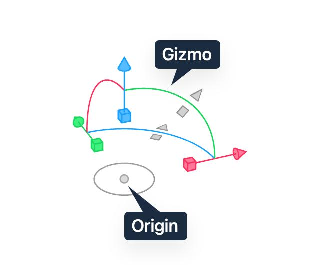
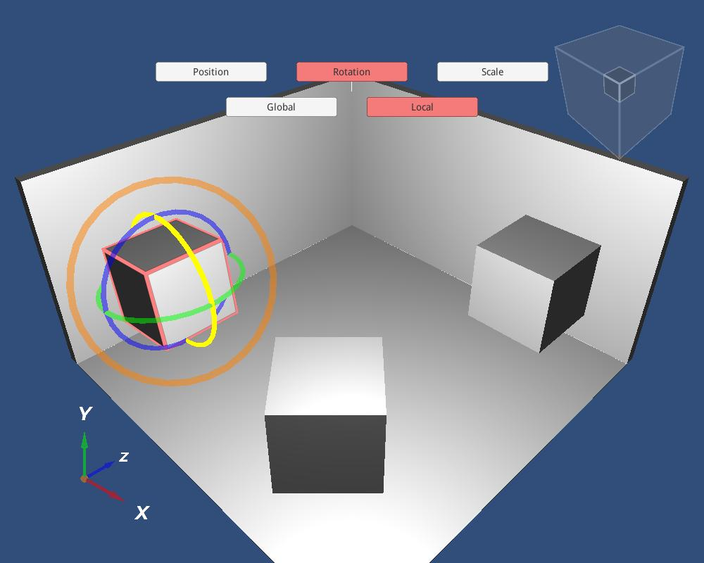

# SUBSPEC-A — Domain Model (v1 implementation contract, revised)

Source decisions: A1–A7 (locked planning baseline).  
Every decision below is translated into implementation details: type definitions, data flow, validation rules, worker responsibilities, frontend interactions, backend/companion responsibilities, failure handling, and tests.

---

## 1. Locked decisions

| ID | Decision | Status |
|---|---|---|
| A1 | Chunk size = 16³, fixed globally for v1. Not a user setting. | Locked |
| A2 | Origin supports integer and half-integer coordinates. Stored as integer half-block units (`Vec3Half`, actual = stored / 2). | Locked |
| A3 | Fractional translations rejected; never silently snapped. Placement translation is `Vec3i` (integer block coordinates). | Locked |
| A4 | `BlockStateId` uses canonical, sorted, value-based identity. Never reference equality. | Locked |
| A5 | Ship a version-pinned Minecraft 1.21.11 vanilla block registry with rotation/mirror rules, air-like classification, stack sizes, tags, categories. | Locked |
| A6 | Palette index thresholds: 1–256 `Uint8Array`, 257–65,536 `Uint16Array`, 65,537+ `Uint32Array`. Index 0 = canonical air. | Locked |
| A7 | Air-like non-owning IDs: `minecraft:air`, `minecraft:cave_air`, `minecraft:void_air`. `minecraft:structure_void` is a real owning block. | Locked |

---

## 2. Type definitions

All types live in `packages/domain/types.ts`. `domain` must not import framework, browser, Node, Three.js, or MCP packages.

### 2.1 Primitives

```ts
// Integer block coordinate (cell index).
export type Vec3i = readonly [number, number, number];

// Fractional world/local point.
export type Vec3d = readonly [number, number, number];

// Half-block grid unit. Actual coordinate = stored value / 2.
// Origin and pivot use this type so half-integer positions are exact.
export type Vec3Half = readonly [number, number, number];

// Chunk coordinate (integer, may be negative). Maps to a 16x16x16 region of block space.
export type ChunkCoord = readonly [number, number, number];

export type Bounds3i = {
  min: Vec3i;
  maxExclusive: Vec3i;
};

export type BlockStateId = {
  id: string;           // normalized namespaced resource location, lowercase
  props: Readonly<Record<string, string>>; // canonical sorted keys
};

export function blockStateId(id: string, props?: Record<string, string>): BlockStateId {
  const normalizedId = normalizeNamespace(id); // lowercase, validates 'namespace:id'
  const canonicalProps = props ? canonicalizeProps(props) : {};
  return Object.freeze({ id: normalizedId, props: Object.freeze(canonicalProps) });
}

export function blockStateEquals(a: BlockStateId, b: BlockStateId): boolean {
  return a.id === b.id && deepEqualSortedProps(a.props, b.props);
}

// Canonical air state. Index 0 in every palette.
export const CANONICAL_AIR: BlockStateId = blockStateId('minecraft:air');

// Air-like classification (A7).
export type AirLikeId =
  | 'minecraft:air'
  | 'minecraft:cave_air'
  | 'minecraft:void_air';

// Registry-registered air-like IDs (modded, explicit only).
export type AirLikeRegistry = Set<string>;
```

### 2.3 NBT AST (typed, replaces `unknown`)

Lives in `packages/domain/nbt.ts`. Preserves every NBT tag type losslessly.

```ts
export type NbtTag =
  | { type: 'byte'; value: number }
  | { type: 'short'; value: number }
  | { type: 'int'; value: number }
  | { type: 'long'; value: bigint }
  | { type: 'float'; value: number }
  | { type: 'double'; value: number }
  | { type: 'byteArray'; value: Uint8Array }
  | { type: 'string'; value: string }
  | { type: 'list'; elementType: NbtElementType; value: NbtTag[] }
  | { type: 'compound'; value: ReadonlyMap<string, NbtTag> }
  | { type: 'intArray'; value: Int32Array }
  | { type: 'longArray'; value: BigInt64Array };

export type NbtElementType =
  | 'byte' | 'short' | 'int' | 'long' | 'float' | 'double'
  | 'byteArray' | 'string' | 'list' | 'compound' | 'intArray' | 'longArray';
```

### 2.4 Chunk and volume storage

```ts
export const CHUNK_SIZE = 16; // A1 — fixed globally for v1

export type VoxelChunk = {
  key: string;                               // signed chunk coordinate key, e.g. "2_-1_0"
  palette: BlockStateId[];                   // index 0 is canonical air (A6, A7)
  indices: Uint8Array | Uint16Array | Uint32Array; // fixed CHUNK_SIZE^3 entries
  revision: number;                          // chunk-level revision for invalidation
};

export type ChunkedVoxelVolume = {
  bounds: Bounds3i;                          // local normalized bounds, min inclusive, maxExclusive exclusive
  chunkSize: typeof CHUNK_SIZE;
  chunks: Map<string, VoxelChunk>;           // all-air chunks omitted
  nonAirCount: number;
  paletteCardinality: number;                // total unique block states across chunks
};
```

Palette index array selection rule (A6):

```ts
export function paletteIndexTypeForSize(paletteSize: number): 'Uint8Array' | 'Uint16Array' | 'Uint32Array' {
  if (paletteSize <= 256) return 'Uint8Array';
  if (paletteSize <= 65536) return 'Uint16Array';
  return 'Uint32Array';
}
```

### 2.3 Transform

```ts
export type Transform = {
  translation: Vec3i; // world block coordinate of the origin pivot (A3 — integer only)
  rotationY: 0 | 90 | 180 | 270;
  mirror: 'none' | 'x' | 'z'; // applied in local space before Y rotation
};

export type BlockEntityRecord = {
  position: Vec3i;          // local integer block coordinate
  nbt: NbtTag;              // compound, must contain 'id' string
};

export type EntityRecord = {
  id: string;
  position: Vec3d;          // fractional local position
  rotation: Vec3d;          // [pitch, yaw, roll] in degrees, fractional allowed
  nbt: NbtTag;              // opaque compound payload
};

export type BiomeVolume = {
  bounds: Bounds3i;         // local bounds matching the placement volume
  palette: string[];        // biome IDs (namespaced)
  indices: Uint8Array | Uint16Array | Uint32Array; // fixed volume entries
  // For formats without 3D biomes, a single biome may be replicated; source distinction preserved in diagnostics.
};

export type PendingTickRecord = {
  position: Vec3i;          // local integer block coordinate
  blockState: BlockStateId;
  tickDelay: number;        // ticks remaining, non-negative integer
  nbt: NbtTag;              // format-specific payload, preserved opaquely
  // A transform handler registered for this block state is required to move ticks correctly;
  // otherwise the transform is warned or refused depending on strict/permissive mode.
};

export type PlacementAncillaryData = {
  blockEntities: Map<string, BlockEntityRecord>;   // key = chunked local position "x_y_z"
  entities: EntityRecord[];
  biomes?: BiomeVolume;
  pendingBlockTicks: PendingTickRecord[];
  pendingFluidTicks: PendingTickRecord[];
  unknownTags: Map<string, NbtTag>;                // source tags not yet modeled, preserved verbatim
};
```

### 2.4 Placement

```ts
export type PlacementSource = {
  format: 'schem-v2' | 'schem-v3' | 'litematic' | 'generated';
  filename?: string;
  regionName?: string;
  dataVersion?: number;
  formatVersion?: number;
  sourceGroupId?: string;
  rawMetadata?: NbtTag;      // typed NBT, preserved verbatim when safe
  diagnostics: Diagnostic[];
};

export type Placement = {
  id: string;
  name: string;
  volume: ChunkedVoxelVolume;
  transform: Transform;
  origin: Vec3Half; // integer or half-integer (A2)
  ancillary: PlacementAncillaryData;
  visible: boolean;
  locked: boolean;
  color?: string;
  createdAt: string;
  source: PlacementSource;
  // D9 / SUBSPEC-D: canonical persistent erase (tombstone) record. Local block positions
  // (keys "x_y_z") that this placement has explicitly erased via overrideAir. A tombstone
  // claims its cell as air that erases underlying placements and is preserved across
  // save / reopen / export (see SUBSPEC-D section 4.3).
  eraseTombstones: Set<string>;
};
```

### 2.5 Project

```ts
export type ImportGroup = {
  id: string;
  name: string;
  sourceFilename: string;
  placementIds: string[];
  sourceFormat: 'schem-v2' | 'schem-v3' | 'litematic';
  sourceMetadata?: NbtTag;
};

export type Project = {
  schemaVersion: number;
  id: string;
  name: string;
  placements: Placement[]; // canonical bottom-to-top order (index zero = bottom)
  importGroups: ImportGroup[];
  overlapPolicy: 'top-wins' | 'bottom-wins';
  conflictOverlay: 'off' | 'conflicts' | 'full';
  metadata: { author?: string; createdAt: string; modifiedAt: string };
  revision: number;
};

export type Selection =
  | { kind: 'placements'; placementIds: string[] }
  | { kind: 'cuboid'; id: string; bounds: Bounds3i; scope: 'world' | 'placement'; placementId?: string };
```

### 2.6 Diagnostic

```ts
export type Diagnostic = {
  code: string; // stable code from central registry (see SUBSPEC-B B7)
  severity: 'error' | 'warning' | 'info';
  message: string;
  details?: Record<string, unknown>;
  remediation?: string;
};
```

---

## 3. Coordinate math and transforms

All coordinate conversions live in `packages/domain/coordinates.ts`. UI, renderer, MCP, format adapters, and commands must call these helpers.

### 3.1 Mirror-plane conventions and rotation direction

Mirror is applied in local space first, then Y rotation. All transforms operate around the **origin pivot**.

- `mirror: 'x'`: negates local X relative to the origin: `x' = -x`. Mirror plane is the local YZ plane at X = origin.x.
- `mirror: 'z'`: negates local Z relative to the origin: `z' = -z`. Mirror plane is the local XY plane at Z = origin.z.
- `rotationY`: clockwise degrees about the world +Y axis when looking down the +Y axis toward the origin.

Rotation matrix for `rotationY = θ` (θ in {0, 90, 180, 270}):

```
| cos θ   0   sin θ |
| 0       1   0     |
| -sin θ  0   cos θ |
```

Concrete mappings applied to the offset-from-origin vector `(x, y, z)`:

| rotationY | mapping |
|---|---|
| 0   | `(x, y, z) -> ( x,  y,  z)` |
| 90  | `(x, y, z) -> ( z,  y, -x)` |
| 180 | `(x, y, z) -> (-x,  y, -z)` |
| 270 | `(x, y, z) -> (-z,  y,  x)` |

Mirror matrices:

| mirror | mapping |
|---|---|
| `'none'` | `(x, y, z) -> ( x,  y,  z)` |
| `'x'`    | `(x, y, z) -> (-x,  y,  z)` |
| `'z'`    | `(x, y, z) -> ( x,  y, -z)` |

Forward transform:

```
worldPoint = translation + R_y(θ) * M( localPoint - origin )
```

where `localPoint` and `origin` are both `Vec3Half`/`Vec3d`, the subtraction is exact half-block arithmetic, and `translation` is integer (`Vec3i`).

### 3.2 Required functions

```ts
export function localPointToWorld(placement: Placement, localPoint: Vec3d): Vec3d;
export function worldPointToLocal(placement: Placement, worldPoint: Vec3d): Vec3d;
export function localBlockToWorld(placement: Placement, localBlock: Vec3i): Vec3i;
export function worldBlockToLocal(placement: Placement, worldBlock: Vec3i): Vec3i;
export function placementWorldBounds(placement: Placement): Bounds3i;
export function resolveEffectiveBlock(project: Project, worldBlock: Vec3i): { block: BlockStateId; owner: string } | null;
export function resolveAllOwners(project: Project, worldBlock: Vec3i): Array<{ placementId: string; block: BlockStateId; localBlock: Vec3i }>;
```

### 3.3 Block mapping rule (resolves the corner/center contradiction)

A block at local integer coordinate `[x, y, z]` occupies unit cell `[x, x+1) × [y, y+1) × [z, z+1)`. Its center is `[x+0.5, y+0.5, z+0.5]`.

To map a block to world space:
1. Compute local center: `c = localBlock + [0.5, 0.5, 0.5]`.
2. Compute offset from origin: `d = c - origin` (exact half-block arithmetic).
3. Apply mirror then rotation: `d' = R_y(θ) * M(d)`.
4. World center: `c' = translation + d'`.
5. World block cell: `floor(c')` component-wise.

Because `translation` is integer, `origin` is half-integer or integer, and the rotation/mirror matrices map half-integers to half-integers, world centers are always half-integer or integer. The floor of such a center is always an integer block cell. **Integer block cells never map to half-integer world positions**, and block corners never map to block centers.

Inverse `worldBlockToLocal`:
1. Compute world block center: `c = worldBlock + [0.5, 0.5, 0.5]`.
2. `d = c - translation`.
3. `d_local = R_y(-θ) * d` (inverse rotation).
4. `d_unmirrored = M_inverse(d_local)` (mirror is its own inverse).
5. `localPoint = origin + d_unmirrored`.
6. Floor with epsilon `1e-9`: `floor(localPoint + 1e-9)` component-wise to recover the integer local block coordinate.

### 3.4 Off-grid rejection

A transform is valid only if every occupied block in the placement maps to an integer world block coordinate, and every transformed block center remains on the **half-block center lattice** (all components half-integers, i.e. block centers, never corners or edges).

Two conditions guarantee lattice membership:

1. `translation` must be integral (`Vec3i`, A3). Fractional `translation` is rejected with `ENGINE_OFF_GRID_TRANSFORM`; never silently snapped.
2. The origin used for block-cell mapping must be integral. With integral `translation` and integral origin, block centers (half-integer triples) map to half-integer world centers. If `origin` is half-integer, `center − origin` is an integer triple, so the transformed world center lands on block corners/edges (integer components), **not** on the half-block center lattice — the blocks are off-grid and the transform is rejected with `ENGINE_OFF_GRID_TRANSFORM`.

Half-integer `origin` (A2) is the visual pivot for the transform gizmo; block-cell mapping is defined on the snapped integer grid. A half-integer origin that would place block centers off the half-block center lattice is off-grid and is rejected at commit, never silently snapped.

If a user drag produces a fractional offset, snap to the nearest half-block unit **before** commit, or reject numeric input with a clear message. The snap decision is explicit in the UI, never silent.

### 3.5 Round-trip invariants

For every supported transform combination:

1. `localPoint -> worldPoint -> localPoint` returns the original point within epsilon `1e-9`.
2. `localBlock -> worldBlock -> localBlock` returns the original block exactly.
3. `placementWorldBounds` contains every transformed occupied block.
4. Rotation by 90° four times returns original orientation and coordinates.
5. Mirror twice returns original orientation and coordinates.
6. Origin world position remains fixed through rotate/mirror around itself: `localPointToWorld(p, origin) == translation` for all rotations/mirrors.
7. Transform composition equals corresponding sequential operations.

### 3.6 Mathematical examples

**Example 1: Integer origin, no mirror, 90° rotation**

`translation = [10, 64, 10]`, `origin = [0, 0, 0]`, `rotationY = 90`, `mirror = 'none'`.

Local block `[2, 0, 3]`, center `[2.5, 0.5, 3.5]`. Offset from origin: `[2.5, 0.5, 3.5]`.
Rotate 90°: `(x, y, z) -> (z, y, -x)` → `[3.5, 0.5, -2.5]`.
World center: `[13.5, 64.5, 7.5]`.
World block: `[13, 64, 7]`. ✓

Round trip: world block `[13, 64, 7]`, center `[13.5, 64.5, 7.5]`.
`d = [3.5, 0.5, -2.5]`. Inverse rotate -90°: `(x, y, z) -> (-z, y, x)` → `[2.5, 0.5, 3.5]`.
`localPoint = [0,0,0] + [2.5, 0.5, 3.5] = [2.5, 0.5, 3.5]`. Block: `[2, 0, 3]`. ✓

**Example 2: Half-integer origin — counterexample (fails block round-trip)**

`translation = [10, 64, 10]`, `origin = [0.5, 0, 0.5]` (stored as `[1, 0, 1]`), `rotationY = 0`, `mirror = 'none'`.

Local block `[0, 0, 0]`, center `[0.5, 0.5, 0.5]`. Offset from origin: `[0, 0.5, 0]`.

Center-floor method (buggy): world center = `[10, 64.5, 10]`. The x and z components are **integers**, i.e. the center lands on block corners/edges, **not** on the half-block center lattice. `floor([10, 64.5, 10])` = `[10, 64, 10]` is ambiguous — the point `[10, 64.5, 10]` lies on the corner shared by four blocks, so the block cell is not uniquely defined.

Round trip (world → local): world block `[10, 64, 10]`, center `[10.5, 64.5, 10.5]`. `d = [0.5, 0.5, 0.5]`. `localPoint = origin + d = [1.0, 0.5, 1.0]`. Floor → `[1, 0, 1]` ≠ original `[0, 0, 0]`. ✗ **Round-trip fails.**

This is the off-grid case from section 3.4: integral translation + half-integer origin places block centers on block corners, so the transform is rejected with `ENGINE_OFF_GRID_TRANSFORM` and never silently accepted.

**Example 3: Mirror X** (integral origin, valid)

`translation = [10, 64, 10]`, `origin = [2, 0, 2]`, `mirror = 'x'`, `rotationY = 0`. (integral origin, valid)

Local block `[3, 0, 2]`, center `[3.5, 0.5, 2.5]`. Offset from origin: `[1.5, 0.5, 0.5]`.
Mirror X: `[-1.5, 0.5, 0.5]`.
World center: `[8.5, 64.5, 10.5]`. World block: `[8, 64, 10]`. ✓

### 3.7 Lattice-safe block mapping (doubled-integer representation)

To make block round-trips exact and provably bijective, all block-cell mapping is carried out in **doubled-integer half-block coordinates** (all positions scaled by 2, so every coordinate is an integer and parity is explicit).

Represent every position in half-block units (`×2`):
- Block cell `[x, y, z]` → cell lower corner `C = [2x, 2y, 2z]` (even triple).
- Block center = `C + [1, 1, 1]` (odd triple — a point on the half-block center lattice).
- Origin `O = [2·ox, 2·oy, 2·oz]` (integer triple; even iff origin is integral block).
- Translation `T = [2·tx, 2·ty, 2·tz]` (even triple, since translation is `Vec3i`).

The block-cell map (cell lower corner → cell lower corner):

```
worldCellHalf = T + R( C − O )
```

`worldCellHalf` is a valid block cell iff every component is **even** (then `worldBlock = worldCellHalf / 2` is integral).

**Lattice theorem.** With integral `translation` (T even) and integral origin (O even), for every block cell C (even):
- `C − O` is even − even = even.
- `R` permutes and negates components; even stays even.
- `T + R(C − O)` is even + even = even.
- So `worldCellHalf` is all-even → `worldBlock` is integral.
- The world block center = `worldCellHalf + [1,1,1]` (half-block units) = all-odd → half-integer world center, always on the half-block center lattice.
- `floor` of a half-integer center is exact and unique; no block corner/edge ambiguity.

**Round-trip proof (inverse).** Work on cell lower corners (even triples). Given world block cell `W` (even), the inverse is:

```
C = O + R⁻¹( W − T )
```

`W − T` = even − even = even; `R⁻¹` preserves even; `O + even` = even + even = even → `C` is a valid cell lower corner. The forward map `worldCellHalf = T + R(C − O)` and this inverse are mutual inverses because `R⁻¹ = Rᵀ` (rotation) and mirror is its own inverse. Applied to centers: `centerWorld = T + R(centerLocal − O)` with `centerLocal − O` = odd − even = odd, `R(odd) = odd`, `T + odd` = odd → world center stays on the half-block center lattice; the inverse rotation returns the exact original local center. Round-trip on centers is exact (no epsilon needed for the block form; the point form uses epsilon `1e-9` only for fractional non-block points).

**Counterexample under the lattice-safe map.** `translation = [10, 64, 10]` (T = [20,128,20], even), `origin = [0.5, 0, 0.5]` (O = [1, 0, 1], x,z **odd**), local block `[0, 0, 0]` (C = [0, 0, 0], even).
- `C − O = [−1, 0, −1]` (x,z odd).
- `R(C − O) = [−1, 0, −1]` (identity rotation, odd stays odd).
- `worldCellHalf = T + R(C − O) = [19, 128, 19]` (x,z **odd**) → not a valid cell lower corner (must be even).
- `worldBlock = [19/2, 128/2, 19/2] = [9.5, 64, 9.5]` → non-integral → **off-grid**, rejected with `ENGINE_OFF_GRID_TRANSFORM`.

So the half-integer-origin counterexample is correctly identified as off-grid under the lattice-safe map: no silently-accepted invalid block, no ambiguous floor, and every accepted transform provably keeps block centers on the half-block center lattice with an exact, bijective round-trip.

### 3.8 Local bounds normalization

Every placement volume is normalized so `volume.bounds.min = [0, 0, 0]` and `volume.bounds.maxExclusive = [width, height, depth]` where all components are positive integers. Import adapters translate source coordinates into this normalized frame, recording the original source offset in `source.rawMetadata` for faithful export. Negative source dimensions are normalized through an explicit signed-axis mapping (see SUBSPEC-B), never treated as malformed.

`placementWorldBounds(placement)`:
1. Compute world min: `localBlockToWorld(placement, volume.bounds.min)`.
2. Compute world max corner: `localBlockToWorld(placement, volume.bounds.maxExclusive - [1, 1, 1])`, then extend by one cell.
3. Return integer `Bounds3i` enclosing all transformed occupied blocks.

---

## 4. Block-state transformations

Rotating or mirroring coordinates without updating directional block states is unacceptable. The `BlockStateTransformRegistry` lives in `packages/domain/block-state-transforms.ts` and is keyed by Minecraft data version.

### 4.1 Registry contract

```ts
export type BlockStateTransformHandler = {
  canHandle(blockId: string): boolean;
  rotate(blockState: BlockStateId, degrees: 90 | 180 | 270):
    | { kind: 'ok'; result: BlockStateId }
    | { kind: 'unsupported'; reason: string };
  mirror(blockState: BlockStateId, plane: 'x' | 'z'):
    | { kind: 'ok'; result: BlockStateId }
    | { kind: 'unsupported'; reason: string };
};

export class BlockStateTransformRegistry {
  private handlers = new Map<string, BlockStateTransformHandler>();
  register(pattern: string, handler: BlockStateTransformHandler): void;
  get(blockId: string): BlockStateTransformHandler | undefined;
  transformRotate(blockState: BlockStateId, degrees: 90 | 180 | 270):
    { result: BlockStateId; warnings: Diagnostic[] };
  transformMirror(blockState: BlockStateId, plane: 'x' | 'z'):
    { result: BlockStateId; warnings: Diagnostic[] };
}
```

If no handler matches a block ID, the transform returns the original state unchanged plus an `unsupported` warning identifying the block ID and property.

### 4.2 Vanilla transformation rules (v1)

Directional properties are transformed by applying the same rotation/mirror matrix `R` (section 3.1) to the property's direction vector. `facing`, `axis`, and `rail` are direction vectors; `stair shape` and `door hinge` are corner/side labels that swap left↔right under mirror and rotate with `facing`.

Every column below is a permutation (bijective). Mirror columns are involutions (self-inverse). `90°⁻¹ = 270°`, `90°⁴ = identity`, `mirror² = identity`, and applying an operation then its inverse restores the original state.

|| Property | 90° | 180° | 270° | Mirror X | Mirror Z ||
||---|---|---|---|---|---|---||
|| `facing=north` | `west` | `south` | `east` | `north` | `south` ||
|| `facing=east` | `north` | `west` | `south` | `west` | `east` ||
|| `facing=south` | `east` | `north` | `west` | `south` | `north` ||
|| `facing=west` | `south` | `east` | `north` | `east` | `west` ||
|| `facing=up` | `up` | `up` | `up` | `up` | `up` ||
|| `facing=down` | `down` | `down` | `down` | `down` | `down` ||
|| `axis=x` | `z` | `x` | `z` | `x` | `x` ||
|| `axis=y` | `y` | `y` | `y` | `y` | `y` ||
|| `axis=z` | `x` | `z` | `x` | `z` | `z` ||
|| `stair shape=inner_left` | `inner_right` | `inner_left` | `inner_right` | `inner_right` | `inner_left` ||
|| `stair shape=inner_right` | `inner_left` | `inner_right` | `inner_left` | `inner_left` | `inner_right` ||
|| `stair shape=outer_left` | `outer_right` | `outer_left` | `outer_right` | `outer_right` | `outer_left` ||
|| `stair shape=outer_right` | `outer_left` | `outer_right` | `outer_left` | `outer_left` | `outer_right` ||
|| `rail shape=north_south` | `east_west` | `north_south` | `east_west` | `north_south` | `north_south` ||
|| `rail shape=east_west` | `north_south` | `east_west` | `north_south` | `east_west` | `east_west` ||
|| `door hinge=left` | `right` | `left` | `right` | `right` | `left` ||
|| `door hinge=right` | `left` | `right` | `left` | `left` | `right` ||

Derivation notes:
- `facing`, `axis`, `rail`: rotate/reflect the direction vector by `R`. E.g. `facing=north` is direction `(0,0,-1)`; `R₉₀(x,y,z)=(z,y,-x)` maps it to `(-1,0,0)` = `west`. Mirror X flips `x`, Mirror Z flips `z`.
- `axis` is an undirected axis line, so `x` and `-x` are both `axis=x`; mirror flips do not change an axis line (`mirror X: x→x, z→z`; `mirror Z: x→x, z→z`).
- `rail` follows its run axis (`north_south` = Z axis, `east_west` = X axis); mirrors do not change a rail's run axis.
- `stair shape` / `door hinge`: left↔right under mirror; rotation cycles left→right→left under 90°/270°, identity under 180°.

Multipart and variant blocks: each constituent state transformed independently; if any constituent lacks a handler, the whole block is flagged unsupported.

Waterlogged, age, and other non-directional properties are preserved unchanged.

### 4.3 Unknown modded blocks

- Unknown block IDs are preserved exactly; their properties are not guessed.
- If no handler exists for a state during a transform that bakes orientation into local coordinates (bake, export of transformed placement, flatten), the transform is unsupported for that state.
- Strict mode: refuse the operation and list unsupported block states and counts.
- Permissive mode: proceed only after explicit acknowledgement; record diagnostics for each unsupported state.
- Operations that do not bake orientation (move, rotate in viewport) retain the state unchanged; rendering uses missing-model fallback if needed.

### 4.4 Block-entity and entity orientation during transforms

- Block entities move with their owning block position. NBT fields encoding orientation are preserved opaquely unless a registered handler transforms them; otherwise warn.
- Entities: fractional `position` and `rotation` are transformed by the same matrix as block centers; yaw adjusted by `rotationY` and mirrored appropriately.

---

## 5. Chunk architecture

### 5.1 Voxel indexing formula

Within a chunk, local block coordinate `[cx, cy, cz]` (each 0–15) maps to a flat index:

```
index = (cy * CHUNK_SIZE + cz) * CHUNK_SIZE + cx
```

Equivalently: `index = cy * 256 + cz * 16 + cx`. X is the fastest-varying axis.

The index array has exactly `CHUNK_SIZE^3 = 4096` entries. Palette index at that index selects a `BlockStateId` from `chunk.palette`. Index 0 is always canonical air.

### 5.2 Negative-coordinate chunk mapping (floor division)

World block coordinate `[wx, wy, wz]` maps to chunk coordinate:

```
chunkCoord = [ floorDiv(wx, 16), floorDiv(wy, 16), floorDiv(wz, 16) ]
localInChunk = [ euclideanMod(wx, 16), euclideanMod(wy, 16), euclideanMod(wz, 16) ]  // 0..15
```

Where `floorDiv(a, b) = Math.floor(a / b)` and `euclideanMod(a, b) = ((a % b) + b) % b`.

Examples:

| World X | Chunk X | Local X |
|---|---|---|
| 15 | 0 | 15 |
| 16 | 1 | 0 |
| -1 | -1 | 15 |
| -16 | -1 | 0 |
| -17 | -2 | 15 |

Chunk key serialization: `key = "${cx}_${cy}_${cz}"` with signed integers. All-air chunks are omitted from the `Map`; querying a missing key returns canonical air.

### 5.3 Palette validation

- Palette index 0 must be `CANONICAL_AIR` (`minecraft:air`).
- Palette entries must be unique `BlockStateId` values (value-based equality).
- Palette size must match index array type: `Uint8Array` → ≤256 entries, `Uint16Array` → ≤65,536 entries, `Uint32Array` → bounded by config.
- Out-of-range index values in `indices` are rejected at load time.
- Palette may contain non-air air-like blocks (`cave_air`, `void_air`, `structure_void`) at non-zero indices; they are distinct from canonical air.

### 5.4 All-air chunk omission

A chunk where every index is 0 (canonical air) is **not** stored in `chunks`. It is omitted entirely. Reading a missing chunk returns canonical air for all positions.

Non-owning air-like blocks (`cave_air`, `void_air`) are **not** automatically converted to canonical air. They are stored as their own palette entries and contribute to `nonAirCount` if the registry classifies them as non-air. Canonical air only is omitted.

### 5.5 Air vs air-like distinction

- Canonical air (`minecraft:air`, palette index 0): non-owning, omitted from storage, does not contribute to overlap or conflict.
- `cave_air`, `void_air`: non-owning for conflict resolution (air-like per A7), but **preserved as distinct block states** in the palette and chunks. Not converted to air on import or export.
- `structure_void`: owning block, contributes to overlap and conflicts, stored normally.
- Modded air-like: only via explicit registry registration; never guessed.

---

## 6. Worker ownership (immutable snapshots / copy-on-write)

Transferring an `ArrayBuffer` to a worker detaches it from the main thread. To prevent workers from invalidating the live project before commit:

### 6.1 Immutable snapshots

All domain model objects (`Project`, `Placement`, `ChunkedVoxelVolume`, `VoxelChunk`) are **deeply immutable** after creation. TypeScript `readonly` at the type level plus runtime `Object.freeze` where performance permits.

Mutation produces a **new** object graph sharing unmodified subtrees (structural sharing):
- `Project` revision increments on commit.
- `Placement` objects are replaced wholesale when their volume or transform changes.
- `VoxelChunk` objects are replaced when their `indices` or `palette` change.
- Unchanged chunks are referenced by identity, not copied.

### 6.2 Worker buffer ownership

Worker protocol (typed messages, no arbitrary class instances):

```ts
type WorkerMessage<T> = {
  requestId: string;
  type: 'import' | 'export' | 'region_op' | 'conflict_index' | 'bake' | 'mesh';
  payload: T;
  transfers?: ArrayBufferLike[]; // explicitly declared transfers
};
```

Ownership rules:
1. The main thread owns the live project. Workers never receive references to live `Project`, `Placement`, or `Map` objects.
2. Workers receive **serialized snapshots**: JSON-compatible project metadata plus `ArrayBuffer` views of chunk data. Chunk `indices` buffers may be **transferred** (detached from main thread) only when the worker takes full ownership and returns a new buffer in its result.
3. If a worker transfers a buffer and the operation is cancelled before commit, the buffer is lost; acceptable because the main thread retains its own copy (copy-on-write: the main thread only hands over a buffer it no longer needs, or a clone).
4. Worker results are **new** buffers and objects. The main thread applies them atomically at commit time only if `project.revision` still matches `baseRevision`.
5. Stale worker results (revision mismatch) are discarded; their buffers are released.
6. Cancellation: `AbortController` signal; worker checks before each chunk batch and returns partial results marked `cancelled`. Partial results are never committed.

### 6.3 Copy-on-write for chunk edits

Region operations (fill, replace, delete, etc.):
1. Snapshot affected chunk keys and their current `indices` buffer references.
2. For each affected chunk, clone the `indices` buffer (copy-on-write) if the chunk is shared; otherwise operate on the worker's private copy.
3. Compute deltas: `{ chunkKey, beforeBuffer, afterBuffer, beforePalette, afterPalette }`.
4. Main thread applies deltas atomically: creates new `VoxelChunk` objects with new buffers, replaces in volume, increments project revision.

No worker can hold the only reference to a live chunk buffer.

---

## 7. Serialization

Ordinary JSON cannot serialize `Map`, `Set`, typed arrays, `BigInt`, or `ArrayBuffer` correctly. Binary codecs are required.

### 7.1 Binary chunk format

File: `placements/<placement-id>/chunks/<cx>_<cy>_<cz>.bin`

Layout (little-endian):

| Offset | Size | Field |
|---|---|---|
| 0 | 4 | Magic `0x564F4F43` ("VOOX") |
| 4 | 2 | Version (uint16, currently 1) |
| 6 | 4 | Chunk X (int32) |
| 10 | 4 | Chunk Y (int32) |
| 14 | 4 | Chunk Z (int32) |
| 18 | 4 | Palette entry count N (uint32) |
| 22 | N × variable | Palette entries |
| after palette | 4 | Index array type code: 1=Uint8, 2=Uint16, 4=Uint32 |
| +4 | 4096 × typeSize | Index array data (little-endian) |
| end | 32 | SHA-256 of preceding bytes |

Palette entry encoding:

| Offset | Size | Field |
|---|---|---|
| 0 | 2 | Block state ID string length L (uint16) |
| 2 | L | ID UTF-8 bytes |
| +L | 2 | Property count P (uint16) |
| +2 | P × variable | Property pairs |

Property pair:

| Offset | Size | Field |
|---|---|---|
| 0 | 2 | Key length K (uint16) |
| 2 | K | Key UTF-8 bytes |
| +K | 2 | Value length V (uint16) |
| +2 | V | Value UTF-8 bytes |

Properties sorted canonically by key. All integers little-endian. Strings UTF-8 without BOM.

### 7.2 NBT binary format

Standard Minecraft NBT (big-endian tagged values as used by Sponge/Litematica):

| Tag type | ID | Payload |
|---|---|---|
| End | 0 | none |
| Byte | 1 | int8 |
| Short | 2 | int16 BE |
| Int | 3 | int32 BE |
| Long | 4 | int64 BE |
| Float | 5 | IEEE 754 binary32 BE |
| Double | 6 | IEEE 754 binary64 BE |
| Byte Array | 7 | int32 BE length + bytes |
| String | 8 | int16 BE length + UTF-8 bytes |
| List | 9 | int16 BE element type + int32 BE count + elements |
| Compound | 10 | named entries terminated by End |
| Int Array | 11 | int32 BE length + int32 BE values |
| Long Array | 12 | int32 BE length + int64 BE values |

The domain NBT AST (`NbtTag`) round-trips through this format. `bigint` values for `long` and `longArray` preserve 64-bit integers exactly. Serialization is deterministic: compound entries written in source insertion order unless canonicalization is explicitly requested for export normalization.

### 7.3 Checksums (single canonical scheme)

- Every chunk `.bin` file ends with a SHA-256 of all preceding bytes in that file.
- `manifest.json` contains `checksums`: a map of every archive entry path to its SHA-256 (`manifest.checksums` is the **single source of truth** for archive integrity; there is no separate `checksums.json`).
- `manifest.checksums` also covers `project.json` (replacing any per-file checksum for it).
- On re-open, every path in `manifest.checksums` is verified against its entry's SHA-256; mismatch yields `CORRUPT_ARCHIVE` diagnostic and recovery offer.

### 7.4 Compression

`.vxproj` archive uses ZIP64 with DEFLATE compression level 6 for chunk payloads and metadata. Already-compressed assets stored uncompressed within the ZIP.

### 7.5 Deterministic archive serialization

```
project.vxproj
├── manifest.json            // schemaVersion, app version, asset profile, createdAt, modifiedAt, checksums (single source of truth)
├── project.json             // canonical JSON: placements, importGroups, metadata, revision
├── placements/
│   └── <placement-id>/
│       ├── volume.json      // bounds, chunk keys, nonAirCount
│       ├── transform.json
│       ├── origin.json
│       ├── ancillary.json   // serialized NBT AST as JSON (typed)
│       └── chunks/
│           └── <cx>_<cy>_<cz>.bin
├── assets/
│   └── custom-resource-pack-references.json
└── (no separate checksums.json — manifest.checksums is authoritative)
```

`project.json` serialized with deterministic key order (insertion order for compound NBT, sorted keys for block-state props). No `undefined`, `NaN`, or `Infinity`. `bigint` values serialized as decimal strings with a type marker.

Custom serializer converts the domain model to a JSON-compatible intermediate form before `JSON.stringify`; chunk binaries carry raw typed data. Ordinary `JSON.stringify` is not used for the full project because `Map`/`Set` serialize as `{}`, typed arrays as objects with numeric keys, `BigInt` throws, and `ArrayBuffer` is unsupported.

---

## 8. Validation rules

### 8.1 Safe-integer validation

All block coordinate arithmetic uses `Number.isSafeInteger` checks before allocation:
- `volume.bounds.size = maxExclusive - min` per axis must be `> 0` and `< Number.MAX_SAFE_INTEGER`.
- `totalCells = size.x * size.y * size.z` validated with `BigInt` multiplication before conversion to number; must not exceed `Number.MAX_SAFE_INTEGER`.
- Estimated byte allocation = `totalCells × indexBytes` compared against memory budget before allocation.
- Chunk coordinates and block coordinates validated as safe integers at every API boundary.

### 8.2 Block state (A4)

- Normalize namespaced IDs to lowercase `namespace:id`; reject malformed IDs.
- Empty properties become `{}`.
- Sort property keys canonically; never rewrite valid values.
- Equality is value-based: compare `id` string and deep-equal sorted `props`.
- Never use object reference equality.
- Unknown modded block IDs are preserved as data; rendering uses missing-model fallback.
- Unknown properties are preserved as strings. Validation is against the selected Minecraft data version / resource pack, not hard-coded.

### 8.3 Origin and translation (A2, A3)

- `origin`: `Vec3Half` (any whole number of half-block units).
- `transform.translation`: `Vec3i`. Fractional input rejected with `ENGINE_OFF_GRID_TRANSFORM`; never snapped silently.
- A transform that would put blocks off-grid is rejected.

### 8.4 Palette (A6)

- Index 0 is always canonical air.
- Palette size 1–256 → `Uint8Array`; 257–65,536 → `Uint16Array`; >65,536 → `Uint32Array`.
- Palette index overflow beyond `Uint32Array` range is a hard rejection.

### 8.5 Air-like (A7)

```ts
const VANILLA_AIR_LIKE: AirLikeRegistry = new Set([
  'minecraft:air',
  'minecraft:cave_air',
  'minecraft:void_air',
]);

export function isAirLike(blockId: string, registry: AirLikeRegistry): boolean {
  return registry.has(blockId);
}
```

`minecraft:structure_void` is NOT air-like. Modded air-like IDs require explicit registry registration; never guess.

### 8.6 Project invariants

Invariants checked after every committed transaction:
1. `Project.placements` is an array; no duplicate `placement.id`.
2. Every `Placement.id` referenced by an `ImportGroup.placementIds` exists.
3. Every `Placement.volume.bounds.min` = `[0, 0, 0]`.
4. Every `Placement.transform.translation` is `Vec3i` (integer components).
5. Every `Placement.origin` is `Vec3Half` (integer half-block components).
6. Every chunk `key` maps to `chunkCoord` within `volume.bounds`.
7. Every chunk `palette[0]` is `CANONICAL_AIR`.
8. Every chunk `indices` length equals `CHUNK_SIZE^3` (4096).
9. `project.revision` is a non-negative integer, incremented by exactly 1 per transaction.
10. `BlockStateId` equality is value-based throughout.

Violation of any invariant yields `ENGINE_INVARIANT_VIOLATION` and halts the commit.

### 8.7 Resource-pack vs block-registry responsibilities

**Block registry** (`packages/domain/block-registry.ts`, version-pinned 1.21.11):
- Authoritative semantic source: valid block-state properties and values.
- Block rotation/mirroring rules (see section 4).
- Air-like classification.
- Vanilla stack-size data.
- Block tags and categories.
- Determines whether a block state is valid for the pinned data version.

**Resource packs** (`packages/resource-packs/`):
- Supply visual models and textures only.
- Do not alter semantic validity of block states.
- Missing model/texture → missing-model fallback + diagnostic; block state remains valid data.

Resource packs are untrusted input: validate zip paths, file count, decompressed size, JSON depth, image dimensions, and texture limits before use.

---

## 9. Data flow

### 9.1 Coordinate conversion flow

```
UI/gizmo (screen delta) -> world delta -> worldPointToLocal inverse -> Vec3Half origin delta
                            -> validate integer half-block units -> commit Transform
Format adapter (source coords) -> normalized local block coords (origin [0,0,0]) -> ChunkedVoxelVolume chunks
Command (region op) -> world bounds -> per-placement worldBlockToLocal -> chunk mutation (copy-on-write)
Renderer -> placementWorldBounds -> chunk mesh -> Three.js scene nodes
MCP -> same domain queries -> same command bus
```

### 9.2 Block-state identity flow

Import parse → `BlockStateId` canonicalization → store in chunk palette → renderer resolves model/texture via registry → export re-canonicalizes → write format adapter.

### 9.3 Effective block resolution

```ts
resolveEffectiveBlock(project, worldBlock):
  candidates = spatial index query for placements occupying worldBlock
  filter visible placements only
  // Resolve each candidate's contribution at this world block.
  resolved = []
  for placement in candidates:
    localBlock = worldBlockToLocal(placement, worldBlock)
    if placement.eraseTombstones has key(localBlock):
      // D9 tombstone: this placement explicitly erased the cell. It claims the cell
      // as air that erases underlying placements and takes part in precedence.
      resolved.push({ placement, block: CANONICAL_AIR, erased: true, localBlock })
    else if placement block at localBlock is air-like (cave_air, void_air, air per registry):
      // Non-owning air: does not erase, does not occupy.
      continue
    else:
      resolved.push({ placement, block: placement block at localBlock, erased: false, localBlock })
  if resolved is empty: return null
  if overlapPolicy === 'top-wins': winner = last in placements array order
  if overlapPolicy === 'bottom-wins': winner = first in placements array order
  return { block: winner.block, owner: winner.placementId, erased: winner.erased ?? false }
```

`erased: true` means the winning contribution is a tombstone — the cell is explicitly erased air and renders as nothing. A tombstone in a lower-priority placement does not erase a higher-priority placement's real block; precedence still decides the winner.

Conflict classification does not depend on precedence.


---

## 10. Frontend interactions

### 7.1 Inspector (G3)

- Position X/Y/Z: integer-only block inputs plus steppers. Direct typing allowed.
- Origin: integer and half-integer inputs (e.g. `8`, `8.5`). Stored as `Vec3Half`.
- Rotation: 0°, 90°, 180°, 270°.
- Mirror: None / X / Z.
- Fractional drag snaps to grid before commit, or numeric input is rejected with a clear message.

### 7.2 Outliner (G1/G2)

- Placement rows show visibility, lock, name, dimensions, conflict indicator.
- Drag reorder changes `Project.placements` array order; no separate `zOrder` field.
- Precedence label: "Top wins" (top of outliner = highest priority).

### 7.3 Origin editor

- Default origin edit: Keep blocks in place (adjust `transform.translation` by transform of `newOrigin - oldOrigin`).
- Optional Keep pivot fixed: translation unchanged, geometry shifts relative to pivot.
- Origin marker: hot-pink, always-on-top, constant screen-space size, tooltip shows local and world grid-point coordinates.
- Dragging uses defined gizmo plane/axis mode; no ambiguous "plane perpendicular to camera" behavior.

### 7.4 Conflict colors (D5)

Initial tokens (tested on light/dark/transparent):

| Status | Color | Opacity |
|---|---|---|
| Clean | `#22C55E` | 0.12 |
| Same-state overlap | `#EAB308` | 0.42 |
| Different-state conflict | `#EF4444` | 0.52 |

Color is never the only signal: icons, labels, and distinct indicators in the conflict panel. Color-blind-safe alternative palette included in v1.

---

## 11. Backend / MCP companion responsibilities

The domain model is shared. MCP companion uses the same `packages/domain` and `packages/commands` modules.

- MCP read tools (`get_placement`, `get_origin`, `detect_conflicts`, `get_material_list`, etc.) call the same domain queries as the UI.
- MCP mutation tools use the same transactional command API; no MCP-only operation implementations.
- Mutation envelope requires `expectedRevision`, `requestId` (idempotency), and for destructive ops `dryRun` + `confirmationToken`.
- All domain validation rules apply server-side; UI validation is not a security boundary.

---

## 12. Failure handling

|| Condition | Handling ||
||---|---||
|| Fractional translation input | Reject with `ENGINE_OFF_GRID_TRANSFORM`; never silently snap (A3). |
|| Transform puts blocks off-grid | Reject before commit (A2/A3). |
|| Palette size exceeds `Uint32Array` range | Hard rejection; show estimated size. |
|| Unknown modded block ID | Preserve as data; missing-model fallback; diagnostic in report. |
|| `minecraft:structure_void` treated as air | Invariant violation; hard error. |
|| Stale `baseRevision` | Reject/recompute; never apply stale delta. |
|| Worker crash / cancellation | Partial results discarded; buffers released; main thread unchanged. |
|| Chunk checksum mismatch on load | `CORRUPT_CHUNK`; isolate affected placement, offer recovery. |
|| NBT depth/string/array limit exceeded | `NBT_LIMIT_EXCEEDED`; reject import with diagnostic. |
|| Safe-integer overflow in volume arithmetic | `INTEGER_OVERFLOW`; reject before allocation. |
|| Invariant violation | `ENGINE_INVARIANT_VIOLATION`; halt commit, log diagnostic, refuse operation. |

### Visual References

Non-normative visual references for transform pivots and gizmo modes. These illustrations do not override the coordinate equations or transform mappings in sections 2–3, which remain authoritative.

- **Transform gizmo versus object origin/pivot**  
    
  Shows the transform gizmo in relation to the object's origin/pivot point. Use to understand pivot placement; do not infer axis directions, mirror rules, or rotation behaviour from gizmo colours. The coordinate equations and tested transform mappings in the specification remain authoritative.  
  Source: `./refrences/refrence-transform-gizmo-origin.png`

- **Transform axis handles and local/global modes**  
    
  Shows axis handles and local/global transform modes. Use to understand local versus global transform space; coordinate conventions remain per section 3.  
  Source: `./refrences/refrence-transform-local-global.png`

---

## 13. Tests and acceptance criteria

### 13.1 Domain/core tests

- Coordinate conversion inverse properties (local<->world round-trip within epsilon `1e-9`).
- Floor division negative-coordinate chunk mapping (all sign combinations).
- Bounds and integer overflow validation (BigInt multiplication).
- Rotation/mirror composition (4×90° = identity, mirror×2 = identity, origin fixed under rotation).
- Block-state canonicalization and value-based equality.
- Block-state rotation/mirror transformations for all vanilla directional properties (facing, axis, rail shape, stair shape, hinge, door/trapdoor orientation).
- Owner resolution, conflict categories, overlap precedence.
- Fill/replace/delete/copy/cut/paste/hollow/walls/move/bake semantics with copy-on-write chunk deltas.
- Lock/visibility semantics.
- Ancillary data movement (block entities, entities, biomes, ticks) and cleanup.
- History atomicity and memory pruning.
- Deterministic project serialization and migrations (round-trip binary chunk/NBT with checksums).
- NBT AST: all tag types round-trip, `bigint` preserved, compound order preserved.

Use property-based tests for transforms and operation bounds, not only hand-written examples.

### 13.2 Acceptance criteria for SUBSPEC-A (revised)

1. `Vec3Half` stores origin as integer half-block units; `halfToCoord`/`coordToHalf` are exact inverses with no floating-point drift.
2. `CHUNK_SIZE` is exported as `16` and is not user-overridable in v1.
3. Voxel index formula: `index = (cy * 16 + cz) * 16 + cx`; index array length exactly 4096 per chunk.
4. Negative-coordinate chunk mapping uses floor division: `-1` → chunk `-1`, local `15`; `-16` → chunk `-1`, local `0`; `-17` → chunk `-2`, local `15`.
5. Palette index array type follows A6 thresholds; index 0 reserved for `CANONICAL_AIR`; all-air chunks omitted from `Map`.
6. `cave_air` and `void_air` are preserved as distinct palette entries, never auto-converted to `minecraft:air`; `structure_void` is owning.
7. `BlockStateId` equality is value-based; two objects with same `id` and sorted `props` are equal regardless of reference.
8. `Transform` uses integer `translation`, `Vec3Half` `origin`, mirror-before-rotation; fractional `translation` rejected with `ENGINE_OFF_GRID_TRANSFORM`.
9. All seven round-trip invariants pass under property-based testing.
10. Vanilla block-state rotation/mirror table implemented and tested for facing, axis, stair shape, rail shape, hinge, and door/trapdoor orientation.
11. Unknown modded blocks preserved exactly; transform operations without handlers produce warnings or refusal based on strict/permissive mode.
12. NBT AST preserves all tag types, `bigint` longs, compound insertion order, and rejects mixed-type lists.
13. Binary chunk codec round-trips with little-endian fields, SHA-256 checksums, and deterministic palette serialization.
14. Worker ownership: workers never hold live `Project`/`Placement` references; buffers transferred explicitly; stale revision results discarded; main thread unchanged until commit.
15. `packages/domain` has zero imports of framework, browser, Node, Three.js, or MCP packages.
16. Project invariants 1–10 checked after every committed transaction; violations halt the commit.

---

**Next:** SUBSPEC-B (File Formats) will follow once Subspec A is accepted.