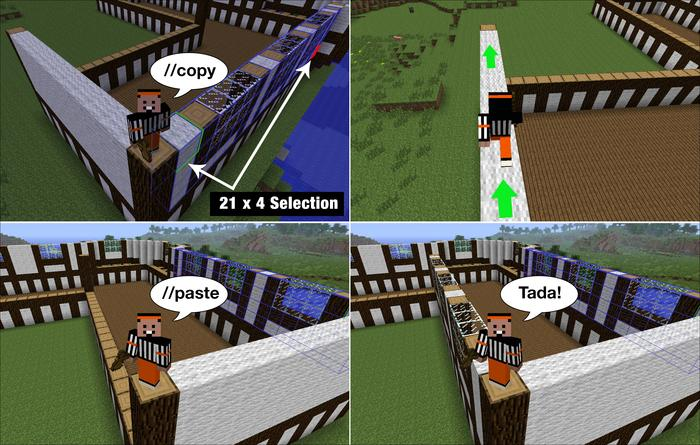
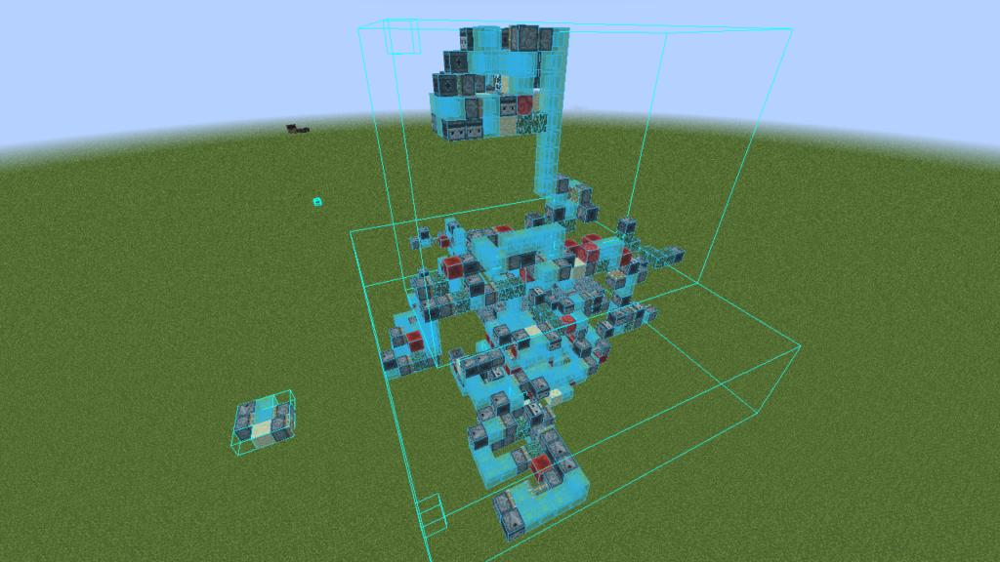

# SUBSPEC-D — Editing Engine (v1 implementation contract)

Source decisions: D1–D8 (locked planning baseline).  
Cross-checked against SUBSPEC-A (domain model, coordinates, chunk storage, transforms), SUBSPEC-B (format adapters, fidelity), SUBSPEC-C (project persistence, history).

Every decision below is translated into implementation details: type definitions, data flow, validation rules, worker responsibilities, frontend interactions, failure handling, and tests.

---

## 1. Locked decisions

| ID | Decision | Status |
|---|---|---|
| D1 | Count actual changed cells, not unchanged air cells. Expose candidate/changed/result metrics. | Locked |
| D2 | Cut only selected, visible, unlocked source placements by default. Add "Include hidden" option. | Locked |
| D3 | Paste anchor = copied selection anchor; default is selection minimum corner. Ghost preview before commit. | Locked |
| D4 | Web Worker offload at 25,000 candidate cells or estimated 8ms. | Locked |
| D5 | Conflict colors: green (#22C55E 0.12) / yellow (#EAB308 0.42) / red (#EF4444 0.52). Color-blind-safe alternative palette in v1. | Locked |
| D6 | Bake limits: maxAabbCells 16,777,216; maxAxis 4096; maxNonAirBlocks 10,000,000. | Locked |
| D7 | Bake primary: context target / last-clicked / largest non-air. Custom world-space origin always available. | Locked |
|| D8 | Move region: all source/destination sets snapshotted before mutation. | Locked |
|| D9 | New Result Placement uses explicit erase/override semantics; air is non-owning but can erase via override flag. | Locked |
|| D10 | Clipboard shared lifecycle and serialization contract for browser and MCP. | Locked |
|| D11 | BlockStateMatcher includes expected property values, not just property names. | Locked |
|| D12 | WallsOperation requires explicit block pattern/state and exact boundary semantics. | Locked |
|| D13 | Candidate-cell, runtime, and memory budgets in addition to changed-cell limits. | Locked |
|| D14 | Group transforms, pivots, and ancillary-data transformations fully specified. | Locked |
|| D15 | Deterministic conflict-index storage, incremental invalidation and negative-coordinate indexing. | Locked |
|| D16 | Bake merge rules for competing block entities, entities, biomes, and pending ticks. | Locked |

---

## 2. Type definitions

### 2.1 Placement management

```ts
export type PlacementLockState = {
  locked: boolean;
  lockReason?: 'user' | 'import' | 'system';
};

export type PlacementVisibility = {
  visible: boolean;
  visibleInViewport: boolean;  // derived from visible + group visibility
};

export type PlacementOrder = {
  index: number;               // position in Project.placements (bottom-to-top)
  groupIndex?: number;          // position within import group, if any
};

export type PlacementReorderOperation = {
  placementId: string;
  fromIndex: number;
  toIndex: number;
};
```

Lock semantics:
- Locked placements cannot be transformed, edited by region operations, deleted, duplicated, baked, or have origins changed.
- Read-only operations and export remain allowed.
- Mixed selection mutations skip no locked items silently. Show locked placements and require user to remove them or explicitly unlock.
- Hide/show is allowed while locked (visibility is not geometry editing).

### 2.2 Selection

```ts
export type SelectionState = {
  activePlacementSelection: string[];     // placement IDs (separate from cuboid)
  activeCuboid: CuboidSelection | null;  // only one active cuboid in v1
  inProgressCuboid: CuboidSelection | null;  // during drag creation
};

export type CuboidSelection = {
  id: string;
  bounds: Bounds3i;
  scope: 'world' | 'placement';
  placementId?: string;               // when scope === 'placement'
  anchor: Vec3i;                      // selection minimum corner (used for paste alignment)
};

export type SelectionCreationMode = 'region' | 'numeric';
export type SelectionResizeAxis = 'x' | 'y' | 'z' | 'all';
```

Selection kinds:
- Placement selection: one or more placement IDs. Selecting a placement makes it the target of placement-level operations: duplicate, delete, move, rotate, mirror, edit origin, bake, export, set visibility/lock.
- Cuboid selection: half-open `Bounds3i`, in world or one placement's local coordinates.
- Only one active cuboid exists in v1. Placement multi-selection may coexist as separate UI selection state.

**Placement border vs selection border (visual distinction):** placement borders (SUBSPEC-E §6.2) show each imported schematic's extent; the cuboid selection border shows the active editing area. They are separate render layers and remain visible independently.

### 2.3 Region operation targeting

```ts
export type RegionOperationMode =
  | 'source-placements'    // default for edits
  | 'new-result-placement';

export type RegionOperationContext = {
  mode: RegionOperationMode;
  bounds: Bounds3i;
  scope: 'world' | 'placement';
  placementId?: string;
  includeHidden: boolean;
  targetPlacements: string[];   // resolved placement IDs to operate on
  overrideAir: boolean;          // D9: if true, air in new result placement erases underlying blocks
};

export type RegionOperationPreview = {
  mode: RegionOperationMode;
  bounds: Bounds3i;
  targetPlacements: Array<{
    placementId: string;
    name: string;
    visible: boolean;
    locked: boolean;
    intersectingBounds: Bounds3i;
  }>;
  candidateCells: number;          // total cells examined
  changedCells: number;            // actually changed cells
  resultingNonAirCount: number;    // non-air blocks after operation
  runtimeEstimateMs: number;       // estimated execution time
  memoryEstimateBytes: number;     // estimated peak memory
  warnings: Diagnostic[];
  blockedByLock: boolean;         // true if any locked placement in target
};
```

### 2.4 Region operations

```ts
export type FillOperation = {
  kind: 'fill';
  state: BlockStateId;
};

export type ReplaceOperation = {
  kind: 'replace';
  matcher: BlockStateMatcher;
  replacement: BlockStateId;
  preserveProperties: boolean;   // if true, keep compatible properties (facing, axis, etc.) when swapping block ID
};

export type BlockStateMatcher = {
  mode: 'exact' | 'block-id-only' | 'block-id-and-properties';
  blockId?: string;                // when mode !== 'exact'
  properties?: Record<string, string>;  // expected property values (D11)
};

export type DeleteOperation = {
  kind: 'delete';
  removeBlockEntities: boolean;  // default true
  removeEntities: boolean;       // default false (separate option)
};

export type CopyOperation = {
  kind: 'copy';
  includeBlockEntities: boolean;
  includeEntities: boolean;
  includeBiomes: boolean;
  scope: 'effective-composite' | 'source-placement';  // D3
};

export type CutOperation = {
  kind: 'cut';
  includeHidden: boolean;   // default false (D2)
  includeBlockEntities: boolean;
  includeEntities: boolean;
  includeBiomes: boolean;
  scope: 'effective-composite' | 'source-placement';
};

export type PasteOperation = {
  kind: 'paste';
  clipboardRef: string;       // session clipboard handle
  targetPosition: Vec3i;      // world block coordinate for clipboard anchor
  intoPlacementId?: string;   // if pasting into active placement
  overrideAir: boolean;       // if true, air in clipboard erases underlying
  // Paste refinements (uploaded-content only):
  pasteAtOriginalPosition: boolean;   // if true, paste where it was copied (targetPosition ignored)
  skipAir: boolean;                   // if true, air blocks in clipboard are not pasted
  previewOnly: boolean;               // if true, ghost-show paste region without committing
  rotationY: 0 | 90 | 180 | 270;    // rotation applied at paste time
  mirror: 'none' | 'x' | 'z';         // mirror applied at paste time
};

export type HollowOperation = {
  kind: 'hollow';
  shellThickness: number;     // default 1
};

export type WallsOperation = {
  kind: 'walls';
  includeTop: boolean;
  includeBottom: boolean;
  wallBlock: BlockStateId;    // D12: explicit block state for walls
  fillInterior: BlockStateId | null;  // null = air (delete)
};

export type MoveRegionOperation = {
  kind: 'move-region';
  sourceBounds: Bounds3i;
  destinationOffset: Vec3i;
  overlapPolicy: 'top-wins' | 'bottom-wins';
  affectedPlacements: string[];  // D10: multi-placement selection
};

export type StackOperation = {
  kind: 'stack';
  sourceBounds: Bounds3i;         // selection bounds to repeat
  count: number;                  // number of copies (default 1)
  offset: Vec3i;                  // per-copy offset in world block coordinates
  shiftSelection: boolean;        // if true, move selection to last stacked copy
  ignoreAir: boolean;             // if true, air cells are not counted as stack content
};

export type RegionOperation =
  | FillOperation | ReplaceOperation | DeleteOperation
  | CopyOperation | CutOperation | PasteOperation
  | HollowOperation | WallsOperation | MoveRegionOperation | StackOperation;
```

### 2.5 Conflict detection

```ts
export type ConflictStatus = 'clean' | 'same-state' | 'state-conflict';

export type OwnerContribution = {
  placementId: string;
  blockState: BlockStateId;
  localBlock: Vec3i;
  zOrder: number;
};

export type ConflictCell = {
  worldBlock: Vec3i;
  owners: OwnerContribution[];
  status: ConflictStatus;
  effectiveOwner: string;       // placement ID of winning block
  effectiveState: BlockStateId;
};

export type ConflictSpatialIndex = {
  chunks: Map<string, ConflictChunkData>;
  lastRevision: number;
};

export type ConflictChunkData = {
  worldChunkKey: string;       // D15: includes negative coords via floor division
  cells: Map<string, ConflictCell>;  // key = "x_y_z" within chunk
  statusSummary: { clean: number; sameState: number; stateConflict: number };
};
```

### 2.6 Bake

```ts
export type BakeOptions = {
  primaryPlacementId?: string;     // context target / last-clicked / largest
  originPreset: 'primary' | 'min-corner' | 'center-bottom' | 'center-center' | 'custom';
  customOrigin?: Vec3Half;          // when originPreset === 'custom'
  includeHidden: boolean;          // default false
  strict: boolean;                 // refuse on unsupported state transforms
  maxAabbCells: number;            // 16_777_216
  maxAxis: number;                 // 4096
  maxNonAirBlocks: number;         // 10_000_000
};

export type BakePreview = {
  selectedPlacements: Array<{ id: string; name: string; nonAirCount: number }>;
  primaryPlacement: { id: string; name: string };
  outputBounds: Bounds3i;
  outputNonAirCount: number;
  stateConflictsResolved: number;
  sameStateOverlapsResolved: number;
  unsupportedBlockStates: Array<{ state: BlockStateId; count: number }>;
  blockEntityConflicts: number;
  entityConflicts: number;
  biomeConflicts: number;
  tickConflicts: number;
  estimatedUndoBytes: number;
  warnings: Diagnostic[];
};
```

---

### 2.7 Clipboard

```ts
export type ClipboardEntry = {
  id: string;
  createdAt: number;
  sourceSelection: CuboidSelection;
  blocks: Map<string, BlockStateId>;
  blockEntities: Map<string, BlockEntityRecord>;
  entities: EntityRecord[];
  biomes?: BiomeVolume;
  ticks: PendingTickRecord[];
  origin: Vec3Half;
};

export type ClipboardState = {
  entry: ClipboardEntry | null;
  serialized: Uint8Array | null;
};
```

Clipboard serialization contract: blocks use SUBSPEC-A binary chunk codec; ancillary data uses SUBSPEC-B NBT codec. Clipboard is session-scoped (not persisted to IndexedDB).

### 2.8 Operation budgets

```ts
export type OperationBudget = {
  maxCandidateCells: number;    // default 1_000_000
  maxChangedCells: number;      // default 250_000 (D13)
  maxRuntimeMs: number;         // default 5000
  maxMemoryBytes: number;       // default 256 * 1024 * 1024 (256 MiB)
};
```

- Candidate cells: total cells examined (including air).
- Changed cells: actually modified cells.
- Runtime: estimated execution time.
- Memory: estimated peak memory allocation.
- If any budget exceeded: refuse or require explicit override with warning.

---

## 3. Coordinate math and transforms

Transforms use the domain model from SUBSPEC-A. All coordinate conversions call `packages/domain/coordinates.ts`.

### 3.1 Transform semantics

- `origin` is a local grid point (integer or half-integer, stored as `Vec3Half`).
- `transform.translation` is the world-space grid point where `origin` is located (integer, `Vec3i`).
- Mirror applied in local space first; Y rotation second.
- `localPointToWorld = translation + rotateY(mirror(localPoint - origin), rotationY)`.
- Block mapping: transform block center, then derive world cell. Never transform only the integer minimum corner.
- Origin world position remains fixed through rotate/mirror around itself.

### 3.2 Origin editing

| Operation | Local origin | World origin |
|---|---|---|
| Move placement | Unchanged | Moves by delta |
| Rotate placement | Unchanged | Remains pivot point |
| Mirror placement | Unchanged | Remains pivot point |
| Duplicate | Copied | Copied plus duplicate offset |
| Edit origin (default: keep blocks in place) | Changes | Moves; translation adjusted so block geometry does not jump |
| Edit origin (keep pivot fixed) | Changes | Remains fixed; blocks shift relative to pivot |
| Bake | Chosen/converted into merged local frame | Preserved as selected bake pivot |

### 3.3 Group transforms

- Default group pivot: center of selected placements' union world bounds, shown before commit.
- User can move group pivot numerically or snap to placement origin/selection corner.
- Group transforms are one compound undo transaction.
- Compose rotation/mirror: apply matrix to each placement's origin point, compose Y rotation/mirror state.

### 3.4 Block-state orientation transforms

- `BlockStateTransformRegistry` keyed by Minecraft data version.
- Support: `facing`, `axis`, `rotation`, `hinge`, `orientation`, rail shape, stair shape, door/trapdoor orientation.
- Transform handlers may rotate/mirror block-entity NBT and entity yaw.
- No generic string substitution.
- If no handler exists: retain state only when operation doesn't bake orientation. For bake/export, mark unsupported and require strict-mode acknowledgement.

---

## 4. Data flow

### 4.1 Region operation flow

```
UI selects tool + bounds → RegionOperationContext
  → RegionOperationPreview (dry computation, shows targets/bounds/counts/warnings)
  → User confirms → RegionOperation command
  → Worker (if > 25,000 cells or > 8ms estimated)
  → Per-placement mutation (source mode) or composite evaluation (result mode)
  → DocumentDelta → commit → revision increment
  → Invalidate conflict spatial index for affected chunks
  → Emit document-change event
```

### 4.2 Source placements mode (default)

- Apply operation independently to every editable placement intersecting the selection.
- Operation affects intersection of cuboid with each placement's transformed bounds, including explicit air cells within bounds.
- Positions outside every placement's bounds remain untouched; gaps between placements not implicitly filled.
- At overlapping positions, each included source placement modified independently.
- Hidden placements excluded by default and listed in preview; user may opt to include them.
- Locked placements not modified; operation blocked until target corrected.

### 4.3 New result placement mode (D9: erase/override semantics)

- Evaluate effective composite in selected cuboid and write result into a new placement.
- **Air is non-owning but can erase via `overrideAir` flag.** When `overrideAir === true`, air cells in the new placement explicitly erase underlying blocks: each air cell written records an erase tombstone in the new placement's `Placement.eraseTombstones` (SUBSPEC-A section 2.4), so the new placement claims those positions as air that erases underlying owners per precedence. When `overrideAir === false` (default), air cells are non-owning and do not erase (no tombstone recorded).
- Tombstones are canonical placement data: they are written to the chunked volume/ancillary record, and are preserved unchanged through save, reopen, and export (`.vxproj` serializes `eraseTombstones` with the placement; reopen restores them; export carries them into the target format's erase semantics). The effective-block resolver (SUBSPEC-A section 9.3) treats a tombstone as an erase contribution that takes part in overlap precedence.
- May fill gaps inside selection (new volume is explicitly the selected cuboid).
- Existing source placements not modified.
- Recommended safe mode for composite-level edits and AI-assisted generation.
- Mode must be visible in inspector and operation preview. No silent mode switching.

### 4.4 Effective-composite vs source-placement copy (D3)

- **Effective-composite copy**: reads the winning block at each world position (after overlap precedence). Includes supported block entities, entities, biomes from the effective owner.
- **Source-placement copy**: reads blocks from a single named placement only, including its ancillary data. Does not resolve overlaps.
- Default for copy tool: effective-composite (safer, matches what user sees).
- User can switch to source-placement mode via modifier or inspector option.

### 4.5 Cut semantics (D2, D4)

- Cut copies the effective composite (top-wins visible block per position) within the selection to the clipboard, then clears the contributing source blocks.
- Cut sources (default): selected ∩ visible ∩ unlocked placements (D2). Hidden, locked, and non-selected placements are never cut sources and are left untouched.
- Every cut-source placement has all of its blocks inside the selection removed (blocks + ancillary data per section 5.8). Removing every cut source's own contribution prevents that placement's hidden blocks from reappearing at a cut position.
- Because non-cut placements are untouched, after the cut any lower-priority placement beneath a removed top block — a visible placement lower in precedence order, or a hidden placement — becomes visible at that position. This revealing is expected and correct.
- "Include hidden placements" option: hidden placements are added to the cut sources, so their blocks are removed too; a position is left empty only when no non-cut placement occupies it.
- Preview shows which owners will be changed before commit.

### 4.6 Clipboard lifecycle (D10)

- Session-scoped clipboard (not persisted to IndexedDB).
- Clipboard entry serialized for MCP transfer: `Uint8Array` of canonical binary format.
- Browser and MCP share the same clipboard format (SUBSPEC-A binary chunk codec for blocks, SUBSPEC-B NBT codec for ancillary).
- Clipboard anchor = minimum corner of copied selection (D3).
- Pasting at cursor position aligns clipboard anchor to that world block coordinate.
- For paste into active placement: convert target through active placement's inverse transform. Do not use active placement's origin implicitly.
- Viewport shows ghost preview before committing.

### 4.6.1 Paste refinements (uploaded-content only)

Paste refinements give builders precise control over where and how clipboard content lands, without creating any new blocks that weren't in the uploaded source.

**Paste at original coordinates (`pasteAtOriginalPosition`)**
- When `true`, the clipboard is pasted at the exact world position where it was originally copied from; `targetPosition` is ignored.
- When `false` (default), the clipboard anchor aligns to `targetPosition` (existing behavior).
- Use case: move an uploaded build back to its original location after editing, or duplicate it at the same coordinates in a different project.

**Skip air (`skipAir`)**
- When `true`, air blocks in the clipboard are not written to the target placement. Existing blocks under air cells remain untouched.
- When `false` (default, when `overrideAir` is also false), air cells are non-owning and do not erase. When `overrideAir` is `true` with `skipAir` `false`, air cells record erase tombstones.
- Use case: paste a building into existing terrain without punching air holes around it.

**Preview only (`previewOnly`)**
- When `true`, the paste region is shown as a ghost preview but no blocks are committed. Returns the affected bounds and block count without incrementing revision.
- Use case: verify alignment against the chunk-border overlay before committing.

**Rotation and mirror at paste time (`rotationY`, `mirror`)**
- Applied to the clipboard content at paste time, before placement at `targetPosition` (or original position). Equivalent to transforming the placement then pasting, but in a single operation.
- Uses the same bijective rotation/mirror tables as SUBSPEC-A section 4.2.

### 4.6.2 Stack operation (uploaded-content only)

Stack repeats the selected content N times with a per-copy offset. It operates on uploaded content only — no new shapes are generated.

```
stack(sourceBounds, count, offset, shiftSelection, ignoreAir):
  For i in 0..count-1:
    copy blocks from sourceBounds into target bounds shifted by i * offset
    if ignoreAir: skip air cells (they are not written and do not overwrite)
  if shiftSelection: set active cuboid selection to the last stacked copy's bounds
```

- `count` must be >= 1. `count = 1` is equivalent to a copy at `offset`.
- `offset` is in world block coordinates; negative offsets are valid (floor-division rules apply for chunk alignment).
- Stack respects placement boundaries: each copy is written into the placement that owns the target cells (source-placement mode) or into a new result placement (result mode with `overrideAir`).
- All copies are committed in a single undo transaction.

### 4.6.3 Selection operations (uploaded-content only)

Selection operations act on the active cuboid selection or placement selection without generating new block geometry.

**Expand / contract**
- Grow or shrink the active cuboid selection by N blocks on chosen axes (x, y, z, or all). Minimum size is 1 block per axis.
- Expanding into negative coordinates is valid; floor-division rules apply for chunk alignment.

**Shift selection**
- Slide the active cuboid selection box along an axis by N blocks without moving any blocks.
- Use case: reposition the selection frame to match a different part of an uploaded build before running a fill/replace/stack.

**Select by type**
- Select all blocks within the current selection bounds matching a `BlockStateMatcher` (exact / block-id-only / block-id-and-properties with expected values).
- Result: a new cuboid selection tightly bounding the matching blocks, or multiple disjoint cuboids if `groupByConnected` is true.

**Magic / connected select**
- Click one block of an uploaded build; grab the whole connected structure (6-connected, same block state) as the selection.
- Only selects blocks belonging to visible, unlocked placements. Locked placements block selection of their blocks.

### 4.6.4 Import & Place flow (uploaded-content only)

The import-and-place flow lets a user drop a schematic file into the viewport and place it interactively before committing, instead of importing then typing coordinates in the inspector.

**Drag-and-drop import**
- User drags a `.schem` v3, `.litematic`, legacy `.schematic`, or vanilla `.nbt` file onto the viewport.
- File is imported as a new placement in a "pending placement" state (not yet committed to the project).
- Import report is shown: dimensions, non-air block count, palette size, warnings.

**Ghost preview at cursor**
- While the placement is pending, a semi-transparent ghost of the imported blocks follows the cursor in world space.
- Ghost renders at the cursor's world block coordinate, aligned to the placement's anchor (minimum corner of the import bounds by default; configurable to center-bottom or center-center).
- Ghost respects the world chunk grid: chunk-border overlay (if enabled) shows behind the ghost so the user can see alignment to 16-block chunk boundaries.
- Ghost does not write blocks, does not increment revision, and does not create undo history until confirmed.

**Ground snap**
- Holding a modifier key (or toggle in the import panel) snaps the ghost to the ground: the placement's lowest non-air block on Y is aligned to the highest occupied block + 1 directly below the cursor's X/Z column, or to Y=0 if nothing below.
- Snap respects negative coordinates via floor division; the snapped position remains on the world block grid.
- Snap preview updates in real time as the cursor moves.

**Confirm / cancel**
- Click to confirm: ghost becomes a committed placement, added to the project with its transform (translation at the snapped/confirmed position, rotationY=0, mirror=none). Revision increments; undo restores pre-import state.
- Escape or cancel button: pending placement is discarded; no blocks written, no revision change.
- After confirm, the placement is selected and ready for move/rotate/mirror via the W/E gizmo or inspector.

**Import & place is not shape generation**
- No blocks are created beyond what was in the imported file. The flow only positions existing uploaded content.

### 4.6.5 Snap & Align tools (uploaded-content only)

Snap & align tools position existing placements relative to each other without generating new blocks.

**Snap to origin**
- Aligns a placement's local origin ([0,0,0] in its normalized volume) to a target world block coordinate.
- Target can be the cursor position, another placement's origin, or the world chunk grid origin (coordinates divisible by 16).
- After snap, the placement's `transform.translation` is updated so its local [0,0,0] maps to the target world coordinate.

**Align edges**
- Aligns one edge (min or max on X, Y, or Z) of a placement's world bounds to the same edge of another placement's world bounds, or to the cursor's world coordinate.
- Multiple placements can be aligned simultaneously; all selected placements move as a group.
- Alignment preserves each placement's internal layout and rotation.

**Snap to placement**
- Snaps a placement so its bounds touch another placement's bounds along a chosen axis (X, Y, or Z), with an optional gap offset (default 0 blocks).
- Use case: "put build B on the ground next to build A" — snap B's bottom to ground level, then snap B's side to A's side with a 1-block gap.
- Does not merge placements; each remains independently editable.

**Snap rules**
- All snap/align operations respect the world block grid (integer coordinates only).
- Negative coordinates are handled via floor division; snap results are always valid block cells.
- Snap/align is a single undo transaction per operation.
- Snap/align does not bake placements; transforms remain editable.

### 4.7 Conflict detection architecture

- Spatial index of occupied placement chunks keyed by world chunk coordinate (floor division for negatives) (D15).
- Candidate overlap pairs: placements whose transformed bounds/chunk occupancy intersect.
- Compare only populated chunk intersections, using inverse transforms to read source chunk data.
- Cache owner/status data per world chunk; invalidate only chunks touched by geometry/visibility/order/overlap-policy change.
- Placement move invalidates old and new occupied world chunks plus overlap candidates, not whole bounding box.
- Large jobs run in worker, cancellable. UI shows "conflict map updating" while rendering last committed map.
- Result committed only if input project revision still matches; stale worker results discarded.

### 4.8 Verify and material report (uploaded-content only)

**Schematic verify**
- Compare placed blocks in a region against the source placement/schematic they were imported from.
- Report missing blocks (in source but not placed), extra blocks (placed but not in source), and wrong-state blocks (placed but different state/facing/properties).
- Results shown per-placement and per-region; click a report row to highlight every affected block in 3D.

**Material report**
- Count blocks per type within the selection or placement, including block-state variants.
- Exportable list (CSV) of material counts for the active selection.
- Tie into hover: hovering a material row highlights every block of that kind in 3D.

### 4.9 Hover operations (uploaded-content only)

**Block hover highlight**
- When the pointer hovers over an occupied block cell within a visible placement, that block's outline is darkened / tinted to indicate it is the active hover target.
- Highlight color is distinct from selection borders, placement borders, chunk borders, and block borders (lower contrast than selection, higher than ambient).
- Respects placement transforms: the hover target is resolved through the placement's inverse transform, so rotated/mirrored placements highlight correctly.
- Does not render through opaque geometry by default (consistent with block borders).
- Air blocks are not highlighted (no hover target on air).

**Block info tooltip / HUD**
- After a short settle delay (configurable, default 120ms), show a small tooltip/HUD for the hovered block: block name, full state properties (facing, axis, etc.), and world coordinates.
- If multiple placements occupy the same world block (overlap), show the effective (top-wins) block first, then list contributing placements and their states.
- For negative world coordinates, coordinates are shown exactly (no truncation).

**Placement hover**
- Hovering over any block within a placement highlights the placement's boundary (placement border) more strongly, indicating which imported schematic the block belongs to.
- Locked placements show a lock indicator in the hover info; hidden placements are not hover targets.

**Same-type highlight**
- When hovering a block, optionally highlight every block of the same state within the current selection or placement (toggled via a modifier or hover setting).
- When hovering a material-list row, highlight every block of that kind in 3D (Litematica block-list behavior).

**Edge cases**
- Hover over air: no block highlight, no info HUD (shows world coordinates only if configured).
- Hover over chunk boundaries: highlight resolves to the correct block regardless of which chunk it falls in; chunk borders remain visible underneath.
- Hover over overlapping placements: info lists all contributors; the effective block is the one visually highlighted.
- Transparent/glass blocks: highlight uses a wireframe outline that doesn't obscure the block itself.
- Large selections: hover resolution uses the conflict spatial index (D15) so it doesn't scan every block; hover is throttled to 30Hz max (E7).
- WebGL context loss: hover state is cleared and rebuilt from the document on context restoration.
- Hover is session state, not document data: it does not affect revision, export, or undo/redo.

### 4.10 Bake flow

```
Bake command → validate selection (≥2 placements, no locked unless unlocked)
  → Calculate union world bounds of selected placements
  → Evaluate effective block at each position using overlap policy
  → Create axis-aligned output volume (chunked, sparse)
  → Convert winning source block states via BlockStateTransformRegistry
  → Transfer supported block entities: effective owner's entity wins; conflicting entities generate warning
  → Transfer entities: transform positions/rotations; conflicting entities generate warning
  → Transfer biomes: effective owner's biome wins; conflicts generate warning
  → Transfer pending ticks: effective owner's tick wins; conflicts generate warning
  → Choose origin (preset or custom) → convert to baked placement local frame
  → Replace original placements with new placement in one transaction
  → Undo restores all originals, transforms, origins, ancillary data, order, selection
```

Bake must not allocate the entire theoretical AABB if mostly empty. Result remains chunked and sparse. Configurable maximum output volume and non-air block count protect memory. If AABB too large, show estimated dimensions and require split or sparse export.

---

## 5. Validation rules

### 5.1 Selection bounds

- All internal bounds are half-open `[min, maxExclusive)`.
- `size = maxExclusive - min` on each axis.
- UI numeric entry accepts inclusive min/max; core converts max to half-open internally.
- Empty bounds (min >= maxExclusive on any axis) rejected by mutating operations.
- Negative world coordinates valid.

### 5.2 Region operation validation

- Source mode: bounds clipped to each placement's transformed bounds.
- Result mode: full cuboid used.
- Fill/replace/delete: validate block state against registry.
- Copy/cut/paste: validate clipboard exists and format compatible.
- Hollow/walls: validate bounds non-empty; show exact treatment of air cells.
- Move region: compute source/destination cell sets before mutation (D8).

### 5.3 Lock validation

- Locked placements block mutation operations.
- Mixed selection: show locked placements, require removal or explicit unlock.
- Hide/show allowed while locked.

### 5.4 Bake validation (D6)

```ts
const BAKE_LIMITS = {
  maxAabbCells: 16_777_216,
  maxAxis: 4096,
  maxNonAirBlocks: 10_000_000
};
```

- If limits exceeded: refuse, show which limit, offer spatial splitting or smaller selections.
- Never silently discard blocks.
- Limits can be raised through advanced setting after performance testing.

### 5.5 Conflict validation

- Owner count exposed in hover/details.
- Three categories only: clean (1 owner), same-state (2+ owners, all same state), state-conflict (2+ owners, differing states).
- No "orange" status. Yellow for every same-state overlap regardless of count.

### 5.6 Operation budgets (D13)

- Candidate cells: total cells examined (including air).
- Changed cells: actually modified cells.
- Runtime: estimated execution time.
- Memory: estimated peak memory allocation.
- If any budget exceeded: refuse or require explicit override with warning.

### 5.7 BlockStateMatcher validation (D11)

- `exact` mode: compares full `BlockStateId` (id + all props).
- `block-id-only` mode: compares only block ID, ignores all properties.
- `block-id-and-properties` mode: compares block ID + specified properties with their expected values. Properties not listed are ignored (wildcard).
- Example: matcher `{ mode: 'block-id-and-properties', blockId: 'minecraft:oak_stairs', properties: { facing: 'north', half: 'bottom' } }` matches only oak stairs facing north, half bottom, regardless of other properties.

### 5.8 Ancillary data behavior per region operation

| Operation | Block entities | Entities | Biomes | Ticks | Unknown data |
|---|---|---|---|---|---|
| Fill | Remove all in target bounds | Unchanged | Unchanged | Unchanged | Unchanged |
| Replace | Remove if block type changes; keep if compatible handler confirms | Unchanged | Unchanged | Unchanged | Unchanged |
| Delete | Remove attached block entities | Separate option (default false) | Unchanged | Remove ticks for deleted blocks | Unchanged |
| Copy | Include if `includeBlockEntities` | Include if `includeEntities` | Include if `includeBiomes` | Include all | Include |
| Cut | Remove from source placements | Separate option | Unchanged | Remove ticks for cut blocks | Unchanged |
| Paste | Remap coordinates; preserve NBT | Remap positions; preserve NBT | Remap biome volume | Remap tick positions | Preserve |
| Hollow | Remove block entities in hollowed interior | Unchanged | Unchanged | Remove ticks in hollowed interior | Unchanged |
| Walls | Remove block entities in non-wall interior | Unchanged | Unchanged | Remove ticks in non-wall interior | Unchanged |
| Move region | Move with blocks | Transform positions | Transform biome volume | Transform tick positions | Move |

### 5.9 Replace behavior for incompatible block entities

- If replacement block type does not accept the same block entity type: remove old block entity, emit warning with block position and old entity type.
- If replacement block type accepts same block entity type but NBT fields are incompatible: preserve opaquely, emit warning.
- Strict mode: refuse if any incompatible block entity in target. Permissive: proceed with removal + warning.

---

## 6. Worker responsibilities

- Region operations above threshold (25,000 cells or 8ms estimated) run in worker.
- Imports, exports, conflict recomputation use workers regardless of threshold.
- Workers receive typed messages and transferable buffers only.
- Cancellation via `AbortController`; worker checks before each chunk batch.
- Worker results committed only if `project.revision` matches `baseRevision`.
- Stale results discarded; buffers released.

---

## 7. Frontend interactions

### 7.1 Selection tools

- Placement click selects; Shift/Ctrl/Cmd click modifies selection.
- Region mode: first click sets anchor; pointer movement previews box; second click confirms. Escape cancels.
- Numeric entry: exact inclusive min/max, converted to half-open internally.
- Corner/edge handles resize selection.
- Expand/shrink by one block along chosen axes or all axes.
- Select all placements; clear current selection.
- Selection survives tool changes. Deleting referenced placement clears or repairs selection (undoable).
- Selection is editor-session state, not document content.

### 7.2 Region operation UX

- Mode selector (Source placements / New result placement) visible in inspector.
- Preview shows: target mode, affected placements, bounds, non-air blocks changed, total cells visited, warnings.
- Confirmation for destructive deletes and bake with affected item/block counts.
- Progress and cancellation for long jobs.
- Lock-related blocked targets shown before running.

### 7.3 Conflict overlay

- Off: no tint.
- Conflicts (default): yellow same-state, red state-conflict; clean blocks natural textures.
- Full: also green tint on clean blocks.
- Overlay tints material/fragment result, not replacing texture.
- Colors color-blind-aware; labels/icons/patterns in conflict panel; color alone not only signal.

### 7.4 Bake UX

- Bake origin preset selector: primary, min-corner, center-bottom, center-center, custom.
- Primary placement displayed in preview.
- Custom world-space pivot input available.
- Hidden placements listed in preview; user may include.
- Locked placements block bake; shown in preview.
- Confirmation with affected item/block counts.

### Visual References

Non-normative visual references for selection volumes, schematic overlays, and the copy/paste workflow. These illustrations do not infer operation semantics; air erasure, overlap resolution, cut behaviour, placement, and undo/redo must follow the written specification.

- **Selection volume and region boundaries**  
    
  Shows the selection volume and region boundaries. Use to understand selection-volume presentation; operation semantics follow the written specification.  
  Source: `./refrences/refrence-selection-bounds.png`

- **Copy and paste workflow**  
    
  Shows the general copy and paste workflow. Use to understand clipboard and paste presentation; operation semantics follow the written specification.  
  Source: `./refrences/refrence-copy-paste-workflow.png`

- **In-world schematic preview and overlay appearance**  
    
  Shows an in-world schematic preview and overlay appearance. Use to understand overlay rendering; placement and undo/redo semantics follow the written specification.  
  Source: `./refrences/refrence-litematica-overlay.png`

---

## 8. Failure handling

| Condition | Handling |
|---|---|
| Empty selection bounds | Reject mutation with clear message. |
| Locked placement in target | Block operation; show locked placements; require correction. |
| Unsupported block state in bake | Strict: refuse + list states/counts. Permissive: proceed after acknowledgement + diagnostics. |
| Bake exceeds limits | Refuse; show which limit; offer split/smaller selection. |
| Cut with hidden overlaps | Preview shows affected placements; default excludes hidden. |
| Paste with no clipboard | Reject with clear message. |
| Worker crash during operation | Discard partial result; main thread unchanged. |
|| Stale revision | Reject/recompute; never apply stale delta. |
|| Operation exceeds budget | Refuse or require explicit override with warning. |
|| Incompatible block entity in replace | Remove old block entity; warn if data loss. |

---

## 9. Tests and acceptance criteria

### 9.1 Domain/core tests

- Coordinate conversion and inverse properties.
- Bounds and integer overflow validation.
- Rotation/mirror composition.
- Block-state canonicalization and equality.
- Owner resolution, conflict categories, overlap precedence.
- Fill/replace/delete/copy/cut/paste/hollow/walls/move/bake.
- Lock/visibility semantics.
- Ancillary data movement and cleanup.
- History atomicity and memory pruning.
- Property-based tests for transforms and operation bounds.
- BlockStateMatcher: exact, block-id-only, block-id-and-properties with expected values.
- WallsOperation: explicit wall block, top/bottom checkboxes, boundary semantics.
- MoveRegion: multi-placement overlap, source/destination snapshot.
- Bake: competing block entities/entities/biomes/ticks merge rules.
- Clipboard: serialization round-trip, paste anchor alignment, overrideAir semantics.
- Conflict index: incremental invalidation, negative-coordinate indexing, deterministic storage.
- New result placement: overrideAir semantics verified.

### 9.2 Acceptance criteria for SUBSPEC-D (revised)

1. Placement management: select, multi-select, rename, show/hide, lock/unlock, duplicate, delete, reorder, move, rotate, mirror, edit origin, focus, export.
2. Lock semantics: locked placements cannot be transformed/edited/deleted/duplicated/baked/origin-changed; read/export allowed; hide/show allowed.
3. Selection: placement and cuboid kinds; half-open bounds; survives tool changes; deletion clears/repairs.
4. Region operation source/result modes visible and behave exactly as specified.
- Fill/replace/delete/copy/cut/paste/hollow/walls/move/bake/stack with correct bounds clipping (source mode) or full cuboid (result mode).
6. Conflict categories: clean, same-state, state-conflict; no fourth status.
7. Overlap precedence: top-wins (default) and bottom-wins only.
8. Bake: union bounds, effective block resolution, state transform, origin choice, ancillary reconciliation, atomic commit, undo restores all.
9. Bake limits enforced; no silent block discard.
10. Conflict spatial index incremental (not full bounding box scan).
11. Worker offload at 25,000 cells or 8ms.
12. Move region: source/destination snapshotted before mutation.
13. New result placement: air erase via overrideAir flag; default non-erasing.
14. Effective-composite copy default; source-placement copy via modifier.
15. Cut: lower overlapping placements become visible after cut; hidden placements excluded by default.
16. Clipboard: shared lifecycle, serialization for browser/MCP, anchor alignment, ghost preview.
17. BlockStateMatcher: property matching includes expected values.
18. WallsOperation: explicit wall block, top/bottom checkboxes, boundary semantics defined.
19. Ancillary data: block entity/entity/biome/tick/unknown-data behavior defined for every region operation.
20. Replace: incompatible block entities removed with warning.
21. Operation budgets: candidate cells, runtime, memory in addition to changed cells.
22. Group transforms: pivot, rotation/mirror composition, ancillary data transformation.
23. Conflict index: deterministic storage, incremental invalidation, negative-coordinate indexing.
24. Bake merge: competing block entities/entities/biomes/ticks resolved by effective owner.
25. No ambiguous sparse-export promise; no automatic multi-region export.
26. Preview and commit use same immutable snapshot; identical results.
27. Paste refinements: paste at original position, skip air, preview-only, rotation/mirror at paste time — all independent of overrideAir.
28. Stack: repeats selected content N times with offset; ignoreAir skips air cells; shiftSelection moves selection to last copy; single undo transaction.
29. Selection operations: expand/contract/shift selection bounds; select by type; magic/connected select; locked placements block selection of their blocks.
30. Replace: preserveProperties keeps compatible block properties when swapping block ID.
31. Verify: compare placed blocks against source placement/schematic; report missing, extra, wrong-state blocks per-placement and per-region.
32. Material report: per-type block counts for selection/placement; exportable CSV; hovering a row highlights every block of that kind in 3D.
33. Hover: block hover highlight (darkened/tinted outline), block info HUD (name, state, coordinates, contributors), placement hover highlights placement boundary, same-type highlight optional; air not highlighted; no hover through opaque geometry; session state only (no revision/export/undo impact).

---

**Next:** SUBSPEC-E (Rendering & Resource Packs) will follow once Subspec D is accepted.