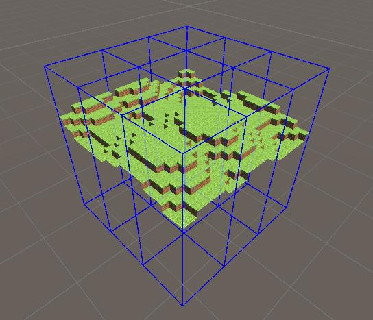
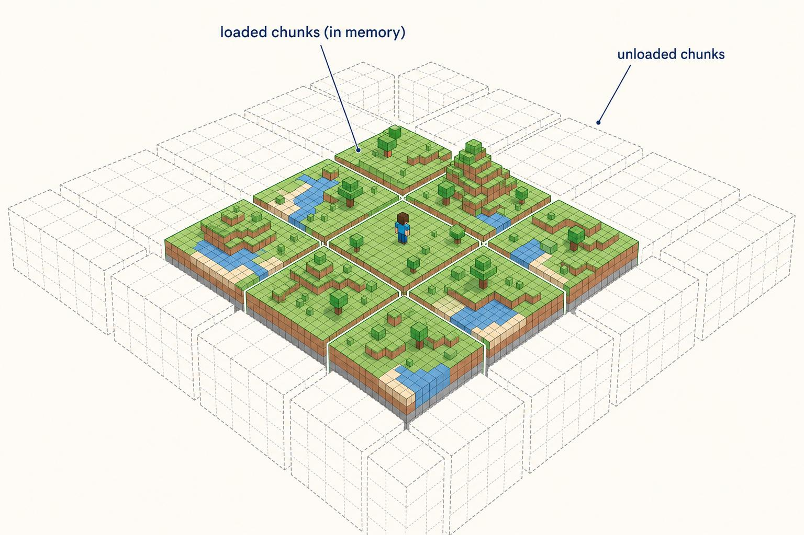
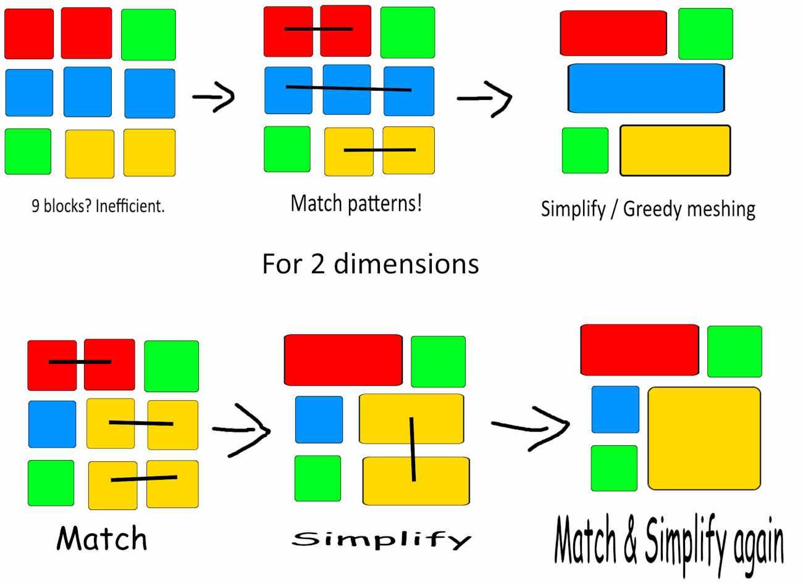
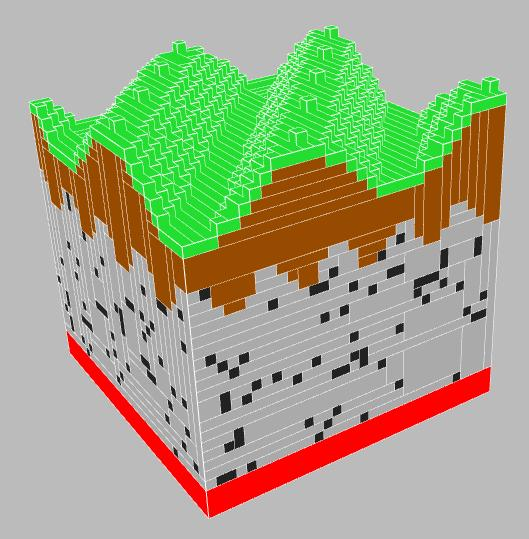

# SUBSPEC-E — Rendering & Resource Packs (v1 implementation contract)

Source decisions: E1–E7 (locked planning baseline).  
Cross-checked against SUBSPEC-A (domain model, chunk storage, transforms), SUBSPEC-B (asset pipeline, format adapters), SUBSPEC-D (editing engine, selection, conflict overlay).

Every decision below is translated into implementation details: type definitions, data flow, validation rules, worker responsibilities, frontend interactions, failure handling, and tests.

---

## 1. Locked decisions

| ID | Decision | Status |
|---|---|---|
| E1 | Renderer: Three.js baseline, Phase 0 evaluation; Lodestone candidate, not required core dependency. | Locked |
| E2 | Asset sourcing: same runtime Mojang pipeline as SUBSPEC-B section 9. | Locked |
| E3 | Missing-model fallback: magenta-and-black checkerboard cube with thin outline. | Locked |
| E4 | Camera: Three.js OrbitControls wrapped in editor controller; preset views + orthographic toggle. | Locked |
| E5 | Texture filtering: nearest magnification, mipmapped minification, user filter switch. | Locked |
| E6 | DPR cap: 1.5 default, 2.0 maximum; dynamically reduce on performance degradation. | Locked |
|| E7 | Hover readouts: world cursor at 30Hz max; detailed inspector after 120ms settle. | Locked |
|| E8 | Placement-local render chunk IDs: `placementId:localChunkKey`. Separate from world-space spatial indexing. | Locked |
|| E9 | Worker returns transferable raw mesh buffers; Three.js objects created and owned by main thread. | Locked |
|| E10 | Resource-pack inheritance, texture-variable resolution, pack.mcmeta, overlays, multipart conditions, weighted model selection, UV locking. | Locked |
|| E11 | Texture animation metadata supported. | Locked |
|| E12 | Weighted model selection deterministic across chunk rebuilds. | Locked |
|| E13 | Exact face culling, chunk-boundary behavior, transparency sorting, cross-placement rendering. | Locked |
|| E14 | Mirroring behavior for face winding, normals, back-face culling. | Locked |
|| E15 | Local mesh coordinate systems and domain transform application. | Locked |
|| E16 | Atlas-page limits, mip-safe gutters, GPU memory budgets, disposal and context recovery. | Locked |
|| E17 | Visual fidelity limitations: lighting, ambient occlusion, unsupported model behavior. | Locked |
|| E18 | Resource-pack manager: enable/disable, reorder, inspect, compatibility, diagnostics. | Locked |

---

## 2. Type definitions

### 2.1 Resource pack

```ts
export type AssetProfile = {
  id: string;
  minecraftVersion: string;        // e.g. "1.21.11"
  packFormat: number;             // 75.0 for 1.21.11
  displayName: string;
  pinned: boolean;                // true for default 1.21.11 profile
};

export type ResourcePackSource =
  | { kind: 'vanilla-runtime'; version: string; assetHash: string }
  | { kind: 'manual-jar'; filename: string; jarHash: string }
  | { kind: 'user-pack'; path: string; priority: number };

export type ResourcePack = {
  source: ResourcePackSource;
  models: Map<string, BlockModel>;
  textures: Map<string, TextureData>;
  blockStates: Map<string, BlockStateDefinition>;
  priority: number;
  loaded: boolean;
  diagnostics: Diagnostic[];
};

export type BlockModel = {
  id: string;                      // namespaced model ID
  elements?: ModelElement[];
  parent?: string;
  textures: Record<string, string>; // texture slot → texture ID
  ambientOcclusion?: boolean;
  guiLight?: 'front' | 'side';
  display?: Record<string, ModelDisplay>;
};

export type ModelElement = {
  from: [number, number, number];
  to: [number, number, number];
  rotation?: { angle: number; axis: 'x' | 'y' | 'z'; origin: [number, number, number] };
  shade?: boolean;
  faces: Record<string, ModelFace>;
};

export type ModelFace = {
  texture: string;
  uv?: [number, number, number, number];
  cullface?: string;
  rotation?: 0 | 90 | 180 | 270;
  tintindex?: number;
};

export type TextureData = {
  id: string;
  width: number;
  height: number;
  pixels: Uint8ClampedArray;      // RGBA
  mipLevels: Uint8ClampedArray[]; // precomputed mips if filtering preference requires
};

export type BlockStateDefinition = {
  variants?: Record<string, ModelReference | ModelReference[]>;
  multipart?: MultipartEntry[];
};

export type ModelReference = {
  model: string;
  x?: 0 | 90 | 180 | 270;
  y?: 0 | 90 | 180 | 270;
  uvlock?: boolean;
  weight?: number;
};

export type MultipartEntry = {
  apply: ModelReference | ModelReference[];
  when?: Record<string, string | string[]>;
};
```

### 2.2 Renderer

```ts
export type RenderChunk = {
  key: string;                        // placement-local chunk identity: "placementId:localChunkKey" (e.g. "p-42_1_0_2")
  placementId: string;                // owning placement; chunk belongs to exactly one placement
  geometry: {
    opaque: THREE.BufferGeometry | null;
    cutout: THREE.BufferGeometry | null;
    translucent: THREE.BufferGeometry | null;
    emissive: THREE.BufferGeometry | null;
  };
  revision: number;
  dirty: boolean;
};

// World-space spatial index: separate from placement-local chunk identity.
// Keyed by world chunk coordinate (floor division, supports negatives). Used for
// frustum culling, cross-placement overlap/conflict queries, and pick tests — not for
// chunk identity, which remains placement-local (RenderChunk.key).
export type WorldChunkSpatialIndex = {
  chunks: Map<string, { placementId: string; localChunkKey: string; worldChunkKey: string }>;
  lastRevision: number;
};

export type RenderPlacement = {
  placementId: string;
  root: THREE.Object3D;                // chunk group parent
  chunkKeys: string[];
  transform: Transform;                // kept at root, not baked into meshes
  visible: boolean;
  locked: boolean;
};

export type RenderScene = {
  placements: Map<string, RenderPlacement>;
  chunks: Map<string, RenderChunk>;
  overlays: {
    selectionBorders: THREE.Object3D[];
    placementBorders: THREE.Object3D[];
    originMarkers: THREE.Object3D[];
    conflictOverlay: THREE.Object3D[];
  };
  camera: CameraState;
};

export type CameraState = {
  position: Vec3d;
  target: Vec3d;
  fov: number;
  orthographic: boolean;
  zoom: number;
  preset?: 'top' | 'bottom' | 'front' | 'back' | 'left' | 'right' | 'isometric';
};
```

### 2.3 Missing model fallback

```ts
export type MissingModelFallback = {
  geometry: THREE.BufferGeometry;       // magenta-and-black checkerboard cube
  material: THREE.Material;            // unlit, no culling
  outline: THREE.LineSegments;         // thin outline
};
```

**Until base assets load:** schematics still import and edit normally; every block renders using the missing-model fallback. A persistent warning banner is shown in the viewport with a **"Load assets"** action that re-opens the asset load panel (SUBSPEC-B §9.1). The banner does not block editing and does not increment revision.

**Base assets loaded:** missing-model fallback is used only for genuinely missing blocks/textures within the loaded asset set.

---

## 3. Data flow

### 3.1 Asset loading flow

```text
App launch → resolve asset profile (pinned 1.21.11 default)
  → check IndexedDB cache for extracted assets
  → if cached: load from cache, mark assets ready
  → if not cached: show "Load Minecraft assets" panel (SUBSPEC-B §9.1)
    → user chooses auto-download or manual JAR
    → worker extraction pipeline (SUBSPEC-B §9.2)
    → cache in IndexedDB
    → mark assets ready
  → build ResourcePack (models, textures, blockstate definitions)
  → resolve model/texture references for each BlockStateId
  → renderer ready
```

Until assets are ready: schematics still import and edit; blocks render with missing-model fallback; persistent warning banner with "Load assets" action is shown. Asset loading does not block schematic editing and does not increment revision.

Manual JAR import: user selects file → same worker extraction pipeline → same cache format.

### 3.2 Resource-pack inheritance (E10)

```
Vanilla base pack (priority 0)
  → User pack 1 (priority 1, overrides vanilla)
  → User pack 2 (priority 2, overrides pack 1)
  → Final resolved pack (merged)

Texture variable resolution:
  #variable in model texture slot → resolve through parent model chain
  → if parent has texture slot, use it
  → if not, inherit from grandparent
  → if unresolved, use missing texture fallback

pack.mcmeta overlays:
  → if overlay matches current format range, apply overlay directory
  → overlay textures/models override base pack entries
```

### 3.3 Transparency sorting (E13)

```
Translucent geometry sorted per-chunk by distance from camera.
  → sort indices by centroid distance (back-to-front)
  → re-sort on camera move (throttled, not per-frame)
  → cross-placement: each placement's translucent chunks sorted independently
  → no global sort across placements (performance)
```

### 3.4 Cross-placement rendering (E13)

```text
Each placement renders independently with its own transform at root.
  → Opaque pass: all placements, front-to-back (depth pre-pass)
  → Cutout pass: all placements, alpha test
  → Translucent pass: per-placement back-to-front sort
  → Emissive pass: additive blending, no depth write
  → Overlays: selection borders, placement borders, origin markers, conflict tint, chunk borders, block borders
```

### 3.5 Texture animation (E11)

```
Texture with animation metadata → worker computes frame index based on world tick
  → update texture pixels in atlas for animated region
  → re-upload to GPU (throttled, not per-frame)
  → interpolate between frames if interpolate: true
```

### 3.6 Chunk borders & block borders overlay architecture

Debug-only viewport overlays for inspecting chunk grid alignment and occupied voxel cells. Non-normative visual guidance only; does not alter document data, export, undo/redo, or block operations.

**World-aligned Minecraft chunk grid (not internal RenderChunks):**
- One Minecraft chunk covers 16 × 16 blocks on X/Z, full world height on Y.
- Chunk boundaries align to world coordinates divisible by 16.
- Chunk index for a world block coordinate uses floor division: `chunkCoord = floor(worldCoord / 16)`. Negative coordinates behave correctly: block `-1` belongs to chunk `-1`, block `-16` belongs to chunk `-1`, block `-17` belongs to chunk `-2`. Never truncate toward zero.
- Do not anchor chunk borders to placement origins. A rotated or translated placement is still compared against the same world-space chunk grid.
- Minecraft chunks (16 × 16 on X/Z) are distinct from internal `RenderChunk`s (placement-local, keyed `placementId:localChunkKey`). Different sizes, coordinate systems, and responsibilities. Do not conflate them.

**Chunk borders (vertical boundary planes):**
- Draw vertical boundary planes along X/Z chunk edges across the visible schematic height.
- Show boundaries even when a chunk contains no blocks, provided it intersects the relevant display region.
- Chunk borders must not be labeled as "loaded/unloaded" status. Only show loaded/unloaded if the renderer has an explicit, reliable residency state; if implemented, that is a separate optional diagnostic mode, not the chunk-border overlay.

**Chunk section borders (horizontal guides):**
- Optional `Chunk Section Borders` control adds horizontal guides every 16 blocks on Y.
- Visually distinct from the main chunk-column boundaries (dimmer / secondary styling).

**Block borders (wireframe around occupied voxel cells):**
- A voxel cell is one block coordinate (1 × 1 × 1).
- Draw the voxel-cell boundary, not the exact mesh silhouette of stairs, slabs, fences, or other non-cube models.
- Do not draw borders around air cells.
- Deduplicate shared edges where possible.
- Respect effective rendered block visibility and placement transforms.
- Do not render through opaque geometry by default.
- Avoid z-fighting with block surfaces (slight depth offset / polygon offset).
- Block borders remain visually distinguishable from placement borders and selection borders (lower visual priority; selection/placement borders retain higher priority).

**Architecture & performance:**
- Do not create one Three.js `Object3D` per block. Batch line geometry into buffers.
- Keep debug overlays separate from normal block mesh geometry (separate render layer / scene objects).
- Generate overlay geometry in a worker; do not block the main thread.
- Rebuild only affected overlay regions after edits or placement changes; avoid rebuilding every border on every camera frame.
- Apply frustum culling and distance/zoom-based detail reduction. At distant zoom levels, adapt or suppress block borders when individual cells become too small to distinguish; the overlay must not make a large schematic unreadable.
- Dispose of obsolete GPU buffers correctly on removal, context loss, or toggle-off.
- Document a performance budget and test with large scenes (e.g. 1M+ non-air blocks): no major frame-rate or memory regression when overlays are enabled.

**Persistence:**
- `Show Chunk Borders`, `Show Chunk Section Borders`, and `Show Block Borders` are independent user viewport preferences, OFF by default.
- Persist across reloads; stored as viewport preferences, not schematic data. They must not affect export, project contents, undo/redo, or block operations, and must not change document revision.
- WebGL context restoration correctly reconstructs all enabled overlays.

### 3.7 Hover rendering (overlay layer)

Hover rendering is a separate, lightweight overlay layer drawn on top of normal block geometry.

**Hover block highlight**
- Single hovered block cell is outlined at a time (the pointer's current target).
- Rendered as a wireframe / outline that does not obscure the block surface; consistent styling with block borders (section 3.6) but lower visual priority than selection borders.
- Resolved through the placement's inverse transform so rotated/mirrored placements highlight correctly.
- Does not render through opaque geometry; air blocks have no hover target.
- Batched into a single small line buffer (one cell = 12 lines); regenerated only when the hover target changes.
- Throttled to 30Hz max (E7); does not block the main thread.

**Hover info HUD data**
- The renderer provides the hovered block's world coordinates, block state ID, properties, and owning placement ID to the UI for the info tooltip/HUD (SUBSPEC-G hover section).
- For overlapping placements, provides the effective block plus all contributors.

**Same-type highlight (optional)**
- When enabled, all blocks matching the hovered block's state within the current selection/placement are highlighted using a second, dimmer line buffer.
- Invalidated only when the selection, hover target, or block states change.

### 3.2 Chunk meshing flow

```
Placement transform/visibility change → mark affected RenderChunks dirty
  → worker: for each dirty chunk:
      - gather block states from placement volume (via inverse transform)
      - resolve model + texture for each block state via registry
      - generate geometry per render pass (opaque, cutout, translucent, emissive)
      - cull internal faces where visually correct
      - return BufferGeometry arrays
  → main thread: update RenderChunk geometry, mark clean
  → Three.js render loop displays
```

Placement transforms kept at `RenderPlacement.root` (Object3D). Moving a placement does not regenerate block meshes; only the root transform changes.

### 3.3 Render chunk invalidation

```
Edit (fill/replace/delete/etc.) → DocumentDelta
  → identify affected world chunks (old + new)
  → mark corresponding RenderChunks dirty
  → worker regenerates only dirty chunks
  → frustum cull on render; upload only changed geometry
```

---

## 4. Validation rules

### 4.1 Resource pack validation

Resource packs are untrusted input. Validate:
- Zip paths: no `..` traversal, no absolute paths.
- File count: configurable max (default 100,000).
- Decompressed size: per-file and total limits.
- JSON depth: max 32 levels.
- Image dimensions: max 4096×4096 per texture.
- Texture count: configurable max.

### 4.2 Model dispatch (1.21.11)

- Block model rotations: handle new model rotation semantics in 1.21.11.
- Block-state dispatch changes: test 1.21.11-specific format changes.
- Do not assume 1.20-era model JSON semantics.
- Multipart states: each constituent evaluated independently.
- Model variants: weighted random selection.

### 4.3 Texture sampling

- Magnification: `NearestFilter` (crisp texels).
- Minification: `LinearMipmapLinearFilter` with mipmaps (or validated pixel-art filter).
- Atlas generation: sufficient gutters/padding to prevent bleed at mip levels.
- Color space: explicit and consistent (sRGB for diffuse, linear for lightmap).
- Alpha: explicit (cutout threshold, translucent blending).
- User preference: "Pixel crisp" (nearest) vs "Stable zoom" (mipmapped).

### 4.4 Device pixel ratio

```ts
const DEFAULT_DPR_CAP = 1.5;
const MAX_DPR_CAP = 2.0;
```

- Dynamically reduce DPR when rendering performance degrades.
- Do not render enormous drawing buffers merely because a device has a high-DPI screen.

### 4.5 Texture-variable resolution (E10)

```
Model texture slot value = "#variable" or "texture:id"
  → if starts with '#': resolve variable through parent model chain
    → walk parent chain: if parent has the variable in its textures map, use it
    → if unresolved after root: use missing texture fallback
  → if literal: use as texture ID directly
  → if not found in resolved pack: missing texture fallback
```

### 4.6 Weighted model selection (E12)

- Weighted variants: select based on `weight` property (default 1).
- Deterministic: use position hash (x, y, z) as seed for selection.
- Same position always selects same variant across chunk rebuilds.
- No random number generator state; pure hash-based selection.

### 4.7 UV locking (E10)

- When `uvlock: true` on a model reference, UV coordinates are locked to the model's base orientation.
- Rotation of the model (x/y on ModelReference) does not rotate UVs.
- Without uvlock, UVs rotate with the model.

### 4.8 Face culling (E13)

- Full-cube blocks: cull faces adjacent to other full-cube opaque blocks.
- Non-cube blocks: cull based on `cullface` property in model face definition.
- `cullface: "up"` → cull if block above is opaque and full-cube.
- Chunk boundaries: do not cull faces at chunk edges (neighbor chunk may not be loaded).
- Cross-placement: faces at placement boundaries are not culled (different placements may have different blocks).
- Transparent blocks: never cull faces adjacent to transparent blocks.

### 4.9 Chunk-boundary behavior (E13)

- Faces at chunk boundaries are always generated (not culled).
- When neighbor chunk loads, re-evaluate culling for boundary faces.
- No visual gaps at chunk boundaries.

### 4.10 Mirroring behavior (E14)

- When a placement is mirrored, face winding is reversed (CCW → CW) to maintain correct back-face culling.
- Normals are negated on the mirrored axis.
- Texture UVs may be flipped depending on `uvlock` and mirror axis.
- Renderer applies mirror at `RenderPlacement.root` transform; mesh geometry is not regenerated.

### 4.11 Local mesh coordinate systems (E15)

- Mesh geometry is in local block coordinates (origin at chunk min corner).
- `RenderPlacement.root` applies the domain `Transform` (translation, rotationY, mirror).
- Domain transform is the single source of truth; renderer never computes its own transform.
- Mesh vertices are in `[0, 16)` local space per chunk.

### 4.12 Atlas-page limits (E16)

- Maximum atlas size: 4096×4096 (GPU-dependent, configurable).
- If textures exceed atlas capacity: split into multiple atlas pages.
- Mip-safe gutters: 8px minimum between textures at mip level 0; scaled for higher mip levels.
- GPU memory budget: configurable (default 512 MiB for textures).
- On context loss: dispose all textures, rebuild from cached source data.

### 4.13 Visual fidelity limitations (E17)

- No dynamic lighting simulation (no redstone lamp glow updates, no torch flicker).
- Ambient occlusion: baked per-vertex based on neighbor opacity (Minecraft-style).
- Unsupported models: missing-model fallback (magenta checkerboard).
- No shader-pack or mod renderer parity.
- Emissive blocks: self-illumination via additive pass, no bloom (v1).
- Water/lava: static texture, no flow animation (v1).

---

## 5. Worker responsibilities

- Asset extraction from JAR (zip open, file extraction, checksum verification).
- Chunk mesh generation (geometry per render pass, face culling, UV assignment).
- Texture atlas generation (packing, gutter, mip computation).
- All heavy computation off main thread.
- Transferable `ArrayBuffer` for geometry data.
- Cancellation via `AbortController`.

---

## 6. Frontend interactions

### 6.1 Camera controls (E4)

- Orbit, pan, zoom, focus selected, fit all, reset camera.
- Preset views: top, bottom, front, back, left, right, isometric.
- Perspective/orthographic toggle.
- Optional grid, world axes, ground plane.
- Viewport coordinate readout and hover block-state inspector.
- Zoom to cursor.
- Configurable camera speed.
- Camera state is session state, not part of schematic export.

### 6.2 Placement borders (E1)

- Thin screen-space white border for all visible placements. This is the **schematic/placement border** — it shows the extent of an imported schematic or placement, independent of any selection.
- Selected placement: stronger border.
- Locked placement: dashed border, still visible.
- Hovered placement: temporary highlight.
- Hidden placement: no viewport border.
- View menu: All / Selected / None.
- Back edges may be dimmed; depth behavior tested on intersecting placements and transparent blocks.

**Selection border (separate from placement border):** the active cuboid selection (SUBSPEC-D §2.2) is drawn as a distinct overlay with its own styling, so a selected region is always distinguishable from a placement's border. A placement can have its border shown while not selected, and can be selected while its placement border uses the default (non-selected) style.

### 6.3 Origin markers

- Distinct hot-pink marker, not conflict colors.
- Always-on-top visual pass so marker not hidden inside model.
- Constant screen-space size with sufficiently large hit target.
- Tooltip shows local and world grid-point coordinates.
- Hidden placement origin hidden; locked origin visible but not draggable.
- Dragging uses defined gizmo plane/axis mode.

### 6.4 Hover readouts (E7)

- World cursor coordinates: update at max 30Hz.
- Detailed block inspector: wait ~120ms after pointer settles.
- Click: immediately select and pin block information.
- Expensive picking: throttle appropriately.
- Do not perform expensive raycasting and block-property inspection on every raw mouse event.

### 6.5 Resource-pack manager (E18)

- Enable/disable individual packs.
- Reorder packs (drag or up/down buttons).
- Inspect pack contents (models, textures, blockstates).
- Compatibility check: pack format vs pinned version.
- Diagnostics: missing textures, invalid JSON, oversized images.
- Add/remove user packs.
- Priority order visible and editable.

### 6.6 Viewport readout

- Show world block under cursor plus hover block-state inspector.
- Should update on pointer move (throttled) or only on click/hover settle (configurable).

### 6.7 Viewport chunk & block border overlays

**View → Overlays controls** (independent, all OFF by default):
- `Show Chunk Borders` — draws vertical boundary planes along world-space Minecraft chunk edges (16 × 16 blocks on X/Z, floor-division aligned, correct for negative coordinates).
- `Show Chunk Section Borders` — draws horizontal guides every 16 blocks on Y; visually distinct (dimmer/secondary) from chunk-column boundaries.
- `Show Block Borders` — draws wireframe voxel-cell boundaries (1 × 1 × 1) around occupied blocks, not mesh silhouettes, not around air cells.

The three controls are independently toggleable; turning one off must not disable the others. They are persisted as user viewport preferences, not schematic data, and must not affect export, project contents, undo/redo, or block operations.

**UI integration:**
- Checkable menu entries / toolbar indicators for quick access, with tooltips explaining each option.
- Accessible via mouse and keyboard navigation with visible focus states.
- Restrained, readable debug-overlay styling: thin contrasting chunk lines, dimmer section guides, finer lower-contrast block borders; placement borders and selection borders retain higher visual priority; stable screen-space line thickness where practical; avoids excessive brightness, opaque surfaces, or visual obstruction so textured blocks remain clearly visible.

**Visual References**

Non-normative visual references for chunk borders and block borders. These illustrations do not override the technical requirements in this section.

- **Chunk spatial boundaries and neighbouring regions**  
    
  Shows chunk spatial boundaries and neighbouring regions. Use to understand world-aligned chunk grid presentation; chunk dimensions remain per this specification.  
  Source: `./refrences/refrence-chunk-boundaries.png`

- **Loaded versus unloaded spatial chunks**  
    
  Shows loaded versus unloaded spatial chunks. Related but separate from the chunk-border overlay; do not infer overlay behavior from loaded/unloaded status.  
  Source: `./refrences/refrence-chunk-loaded-unloaded.png`

- **Greedy meshing and merging adjacent voxel faces**  
    
  Shows mesh optimization intent. Block borders use voxel-cell boundaries regardless of greedy-merged faces.  
  Source: `./refrences/refrence-greedy-meshing.png`

- **Voxel surface and exposed-face mesh structure**  
    
  Shows voxel surface and exposed-face mesh structure. Block borders surround the voxel cell, not this mesh silhouette.  
  Source: `./refrences/refrence-voxel-mesh-topology'.png`

---

## 7. Failure handling

| Condition | Handling |
|---|---|
| Missing model/texture | Missing-model fallback (magenta checkerboard cube + outline) + diagnostic. Until base assets load, all blocks use fallback + persistent warning banner with "Load assets" action. |
| Asset download fails (CORS/network) | `ASSET_DOWNLOAD_FAILED`; automatically surface manual JAR import zone; never a dead end. Phase 0 must verify feasibility. |
| Asset corrupt / wrong version | `ASSET_CORRUPT_JAR` / `ASSET_WRONG_VERSION`; clear message, user may select a different JAR. |
| Asset download cancelled | `ASSET_DOWNLOAD_CANCELLED`; partial cache discarded, no data loss. |
| Asset cache corrupt | `ASSET_CACHE_CORRUPT`; re-download required; never corrupts project data. |
| WebGL context loss | Handle gracefully; reconstruct renderer state from document snapshot. |
| Worker crash during meshing | Discard partial result; main thread unchanged; surface error. |
| Texture atlas too large | Reduce atlas size or split; warn user. |
| High-DPI performance degradation | Dynamically reduce DPR cap. |
| Unsupported model format | Missing-model fallback + diagnostic with model ID. |
| Animation metadata invalid | Skip animation; use static texture + warning. |

---

## 8. Tests and acceptance criteria

### 8.1 Rendering tests

- Visual regression on 1.21.11 vanilla fixture scenes.
- Verify correct model dispatch, texture UVs, transparency, emissive behavior, borders, overlays, selection, origins, transformed placements.
- Verify missing model/texture fallback.
- Verify user resource-pack override precedence.
- Run tests at multiple device pixel ratios and zoom levels.
- Test 1.21.11-specific format changes (model rotations, block-state dispatch).

### 8.2 Visual fixture set (minimum)

- Full cubes, slabs, stairs, fences, walls, panes, doors, trapdoors, logs, leaves, glass, water, lava, rails, redstone wire, crops, signs, banners, beds, chests, end rods, torches, lanterns, chains, plants.
- Multiple facings, halves, shapes, waterlogged states, rotations, multipart variants.
- At least one block model with non-cube geometry and one block entity with separate payload.

### 8.3 Acceptance criteria for SUBSPEC-E

1. Default asset profile pinned to Minecraft Java 1.21.11, resource-pack format 75.0.
2. Resource-pack versions immutable and versioned; no silent asset changes after deployment.
3. User resource packs override vanilla base pack with explicit visible priority order.
4. Missing blocks/models/textures use deterministic missing-model fallback + diagnostics.
5. Resource packs validated: zip paths, file count, decompressed size, JSON depth, image dimensions, texture limits.
6. Chunked mesh generation; no one-mesh-per-block strategy.
7. Opaque, cutout, translucent, emissive geometry through appropriate material/pass paths.
8. Internal face culling where visually correct; non-cube and model-defined culling separate from full-cube adjacency.
9. Rebuild only dirty render chunks after edits or placement changes.
10. Frustum-cull render chunks; avoid uploading unchanged geometry.
11. Placement transforms at object/chunk roots; moving placement doesn't regenerate block meshes.
12. Selection borders, placement bounds, origins, gizmos, conflict overlays as separate render layers.
13. Screen-space handles/borders have stable pixel widths and hit targets.
14. Renderer state disposable and reconstructable from document snapshot.
15. Camera: orbit, pan, zoom, focus, fit all, reset, presets, orthographic toggle, grid/axes/ground plane.
16. Texture sampling: crisp magnification, mipmapped minification, atlas gutters, explicit color space/alpha, DPR cap.
17. Origin markers: hot-pink, always-on-top, constant screen-space size, tooltip with local/world coords.
18. Phase 0 proves Lodestone/custom mesher handles 1.21.11 models, custom packs, multi-region, transparent/cutout, large scenes, incremental updates.
19. Asset distribution decision made: runtime download from official sources or manual JAR fallback; no Mojang assets committed/redistributed.
20. Placement-local render chunk IDs separate from world-space spatial indexing.
21. Worker returns transferable raw mesh buffers; Three.js objects owned by main thread.
22. Resource-pack inheritance, texture-variable resolution, pack.mcmeta, overlays, multipart conditions, weighted model selection, UV locking.
23. Texture animation metadata supported.
24. Weighted model selection deterministic across chunk rebuilds.
25. Exact face culling, chunk-boundary behavior, transparency sorting, cross-placement rendering.
26. Mirroring behavior for face winding, normals, back-face culling.
27. Local mesh coordinate systems and domain transform application.
28. Atlas-page limits, mip-safe gutters, GPU memory budgets, disposal and context recovery.
29. Visual fidelity limitations documented: lighting, ambient occlusion, unsupported model behavior.
30. Resource-pack manager: enable/disable, reorder, inspect, compatibility, diagnostics.

---

**Next:** SUBSPEC-F (MCP Adapter) will follow once Subspec E is accepted.