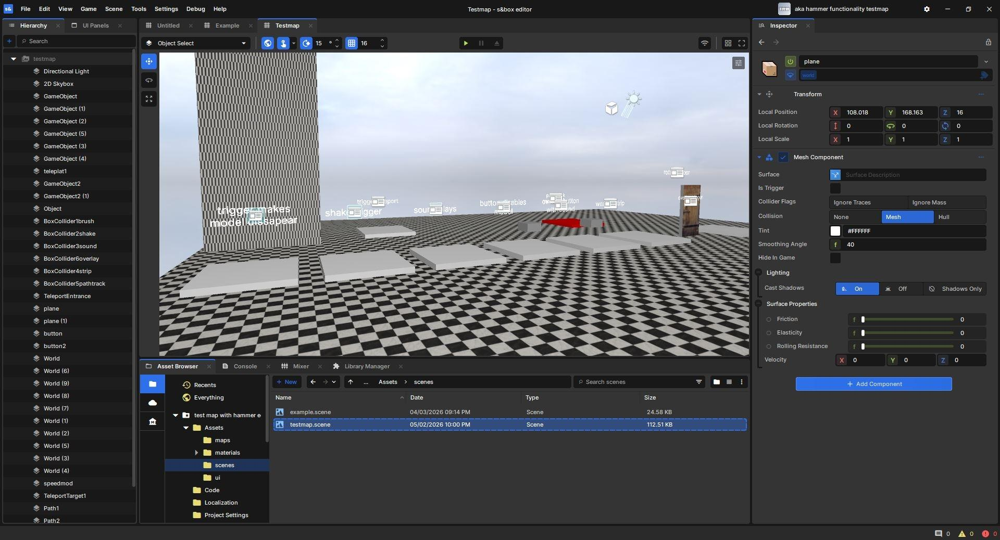
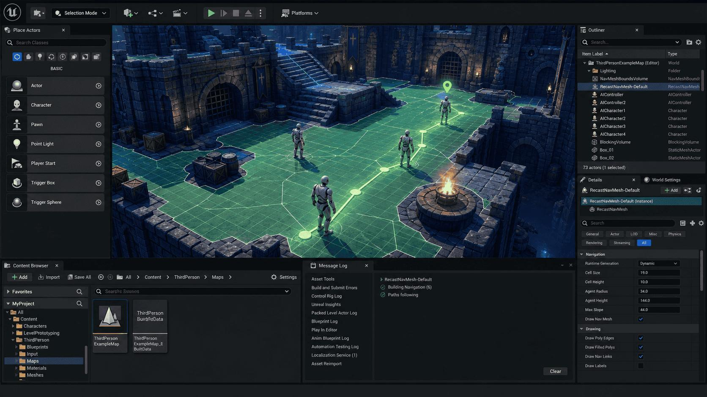

# SUBSPEC-G — UI & Interaction (v1 implementation contract)

Source decisions: G1–G7 (locked planning baseline).  
Cross-checked against SUBSPEC-A (domain model), SUBSPEC-B (format adapters), SUBSPEC-C (project persistence), SUBSPEC-D (editing engine), SUBSPEC-E (rendering), SUBSPEC-F (MCP adapter).

Every decision below is translated into implementation details: type definitions, data flow, validation rules, worker responsibilities, frontend interactions, failure handling, and tests.

---

## 1. Locked decisions

| ID | Decision | Status |
|---|---|---|
| G1 | Layout: resizable, collapsible, dockable panels. Initial: left 260px, right 320px, bottom 220px. | Locked |
| G2 | Outliner: mouse, keyboard, touch-supported reordering. | Locked |
| G3 | Inspector: direct numeric editing plus steppers. Integer/half-integer inputs. | Locked |
| G4 | Conflict navigation: smooth camera fly to conflict center on click. | Locked |
| G5 | Shortcuts: changed scheme; removed conflicting Bake shortcut (Ctrl/Cmd+Shift+B). | Locked |
| G6 | Status bar: essential fields visible; FPS/memory in optional overlay. | Locked |
| G7 | Tooltips: 500ms delay, shortcut in tooltips, ? opens reference, dismissible onboarding. | Locked |

---

## 1.5 Formal design contract (G1-G7)

### Typography
- Font family: system-ui stack (no external font/CDN service). Fallback: `ui-sans-serif, system-ui, -apple-system, BlinkMacSystemFont, "Segoe UI", Roboto, sans-serif`.
- Base size: 13px. Scale: 11px (caption), 13px (body), 14px (heading), 16px (title), 20px (page title).
- Line height: 1.4 for body, 1.2 for headings.
- Font weight: 400 (regular), 500 (medium), 600 (semibold). No bold (700) in UI chrome.

### Spacing
- Base unit: 4px. Scale: 4, 8, 12, 16, 20, 24, 32, 48.
- Panel padding: 8px (compact), 12px (standard), 16px (comfortable).
- Element spacing: 4px (tight), 8px (standard), 12px (loose).
- Separator thickness: 1px. Color: `#2a2a2a` (dark theme).

### Borders
- Panel borders: 1px solid `#333333`.
- Input borders: 1px solid `#444444`; focus: 2px solid accent color.
- Button borders: 1px solid `#555555`; hover: `#666666`.
- Border radius: 0px (sharp corners, S&box-inspired). No rounded cards.

### Panel states
- Default: dark graphite background (`#1e1e1e`).
- Hover: subtle highlight (`#252525`).
- Active/selected: accent tint (`#2a2a3a`).
- Collapsed: thin bar (24px) with icon + expand button.
- Disabled: opacity 0.5, no interaction.
- Loading: spinner overlay, 50% opacity background.

### Menus
- Context menu: right-click, keyboard (Shift+F10), 200ms fade-in.
- Menu items: 28px height, 8px horizontal padding, hover highlight.
- Submenus: 200ms delay before opening.
- Separator: 1px line with 4px vertical margin.

### Tooltips
- Delay: 500ms.
- Max width: 300px.
- Background: `#333333` with 90% opacity.
- Arrow pointing to trigger element.
- Shortcut shown in monospace font at right edge.

### Dialogs
- Modal overlay: `rgba(0,0,0,0.6)` backdrop.
- Dialog: centered, max-width 480px, 16px padding.
- Title: 16px semibold.
- Actions: right-aligned, primary button on right.
- Dismissible via Escape or backdrop click (for non-destructive).

### Empty states
- Centered icon + message + optional action button.
- Muted colors (`#666666` text, `#444444` icon).
- No generic "No data" — specific message per context.

### Error states
- Inline error: red text (`#ef4444`) below affected field.
- Toast notification: bottom-right, 4s auto-dismiss, manual dismiss.
- Full-page error: centered message + retry button + diagnostic code.

### Design tokens (CSS custom properties) — contrast-verified

All text meets WCAG 2.2 AA (4.5:1 normal text, 3:1 large text and UI components) against its background. Ratios verified against `--color-bg-primary`.

```css
--color-bg-primary: #0d0d0d;          /* panel / surface, luminance ~0.018 */
--color-bg-secondary: #1a1a1a;        /* raised surface */
--color-bg-tertiary: #252525;         /* hovered / active surface */
--color-border: #999999;              /* 4.6:1 on bg-primary (≥ 3:1 components) */
--color-border-hover: #b3b3b3;        /* 5.8:1 on bg-primary */
--color-text-primary: #eaeaea;        /* ~14:1 on bg-primary (≥ 4.5:1 text) */
--color-text-secondary: #a8a8a8;      /* ~5.6:1 on bg-primary (≥ 4.5:1 text) */
--color-text-muted: #b3b3b3;          /* decorative only; not used to convey information alone */
--color-accent: #4a9eff;              /* ~4.7:1 on bg-primary (≥ 3:1 components) */
--color-accent-hover: #6ab0ff;
--color-error: #ef4444;               /* 5.16:1 on bg-primary (3:1 components, 4.5:1 if used as text) */
--color-error-text: #f94e4e;          /* 5.76:1 on bg-primary, 4.55:1 on bg-tertiary (text-safe) */
--color-warning: #eab308;             /* ~10.7:1 on bg-primary */
--color-success: #22c55e;             /* ~10.2:1 on bg-primary */
--color-conflict-clean: #22c55e;
--color-conflict-same-state: #eab308;
--color-conflict-state: #ef4444;
--spacing-xs: 4px;
--spacing-sm: 8px;
--spacing-md: 12px;
--spacing-lg: 16px;
--spacing-xl: 24px;
--spacing-xxl: 32px;
```

Contrast verification (WCAG 2.2 AA, measured against `--color-bg-primary` = `#0d0d0d`, `--color-bg-secondary` = `#1a1a1a`, `--color-bg-tertiary` = `#252525`):

| Use | Color | Ratio vs bg-primary | Ratio vs bg-secondary | Ratio vs bg-tertiary | Requirement | Pass |
|---|---|---|---|---|---|---|
| Text – primary | `#eaeaea` | 16.16:1 | 12.96:1 | 10.89:1 | 4.5:1 | Yes |
| Text – secondary | `#a8a8a8` | 8.17:1 | 6.55:1 | 5.51:1 | 4.5:1 | Yes |
| Text – muted (decorative) | `#b3b3b3` | 9.27:1 | 7.43:1 | 6.25:1 | 4.5:1 | Yes |
| Border | `#999999` | 6.82:1 | 5.47:1 | 4.59:1 | 3:1 | Yes |
| Border hover | `#b3b3b3` | 9.27:1 | 7.43:1 | 6.25:1 | 3:1 | Yes |
| Accent | `#4a9eff` | 7.06:1 | 5.66:1 | 4.75:1 | 3:1 | Yes |
| Error (component) | `#ef4444` | 5.16:1 | 4.14:1 | 3.48:1 | 3:1 | Yes |
| Error (text on raised) | `#f94e4e` | 5.76:1 | 4.62:1 | 4.55:1 | 4.5:1 | Yes |
| Warning | `#eab308` | 10.13:1 | 8.12:1 | 6.82:1 | 3:1 | Yes |
| Success | `#22c55e` | 8.53:1 | 6.84:1 | 5.75:1 | 3:1 | Yes |

`--color-text-muted` is decorative only and is never the sole carrier of information; conflict status always uses icons, labels, and patterns in addition to color (color-blind-safe alternative palette included in v1).

### Reference screenshots
- Empty project state.
- Single placement selected.
- Multi-placement with conflict overlay.
- Region selection in progress.
- Bake dialog.
- MCP Agent Log with activity.
- Dark theme at 1280×720, 1920×1080, 2560×1600.

### Visual acceptance criteria
- Minimum supported viewport: `1024×768`. The layout is designed and tested at `1280×720`, `1920×1080`, and `2560×1600`; `1280×720` is the baseline design size and `1024×768` is the hard floor (panels collapse per section 6.0 below it).
- No layout overflow or clipping at any supported size (`1024×768` minimum; `1280×720` / `1920×1080` / `2560×1600` tested).
- Dark theme consistent across all panels, dialogs, menus.
- Focus indicators visible on all interactive elements.
- Reduced motion respected (no animations when enabled).
- Color not the only indicator for any state.
- All text meets WCAG 2.2 AA contrast (4.5:1 normal text, 3:1 large text and UI components) against its background; see the verified design-token table in section 1.5.

---

## 2. Type definitions

### 2.1 Layout

```ts
export type PanelConfig = {
  id: string;
  position: 'left' | 'right' | 'bottom' | 'floating';
  width?: number;
  height?: number;
  collapsed: boolean;
  docked: boolean;
  order: number;
};

export type WorkspaceLayout = {
  panels: PanelConfig[];
  viewportDominant: boolean;   // viewport always gets remaining space
  savedLayouts: Record<string, PanelConfig[]>;
  activeLayout: string;
};

export type PanelId = 'hierarchy' | 'inspector' | 'viewport' | 'bottom-dock' | 'toolbar';
```

### 2.2 Shortcut

```ts
export type ShortcutBinding = {
  action: string;
  keys: string;               // e.g. "Ctrl+Z", "1", "Delete"
  editable: boolean;
  category: 'tools' | 'editing' | 'view' | 'file';
  enabled: boolean;
};

export type ShortcutRegistry = {
  bindings: Map<string, ShortcutBinding>;
  typingGuard: boolean;        // true when focus is in input field
  editorSurfaceFocused: boolean;
};
```

### 2.3 Tooltip

```ts
export type TooltipConfig = {
  delayMs: number;            // 500
  showShortcut: boolean;
  position: 'top' | 'bottom' | 'left' | 'right' | 'auto';
};

export type OnboardingState = {
  firstLaunch: boolean;
  dismissed: boolean;
  replayable: boolean;
  completedSteps: string[];
};
```

---

## 3. Data flow

### 3.1 Layout flow

```
User resizes/collapses panel → PanelConfig update → save to localStorage
  → viewport recalculates dominant space
  → layout persisted across sessions
  → "Restore default layout" resets to initial proportions
```

### 3.2 Shortcut flow

```
Keydown event → check typingGuard (if in input, skip)
  → check editorSurfaceFocused
  → lookup binding in registry
  → if found and enabled: execute action, preventDefault
  → if not found: pass through to browser
```

### 3.3 Conflict navigation flow

```
User clicks conflict in panel → select conflict
  → highlight corresponding block/region
  → smooth camera fly to conflict center (animated, not instant)
  → show contributing placements and block states
  → provide "select affected placement" action
  → hover does NOT reposition camera
```

---

## 4. Validation rules

### 4.1 Layout validation

- Panel widths/heights must be positive integers.
- Minimum panel size: 120px width, 80px height.
- Viewport must always have at least 400×300 pixels.
- Collapsed panels retain their last size for restore.

### 4.2 Shortcut validation

- Shortcuts must not fire while typing in text/number inputs.
- No duplicate bindings for the same action.
- Editable shortcuts stored in user preferences.
- Default shortcuts cannot be deleted, only remapped.

### 4.3 Tooltip validation

- Tooltip delay minimum 200ms, maximum 1000ms.
- Shortcuts shown only when binding exists.
- Onboarding dismissible on first launch; replayable from settings.

---

## 5. Worker responsibilities

- None specific to UI. UI runs on main thread.
- Heavy operations (import, export, meshing, conflict indexing) delegated to workers per SUBSPEC-D/E.

---

## 6. Frontend interactions

### 6.0 Desktop-first responsive behavior

- Minimum supported viewport: 1024×768.
- Below 1280px width: auto-collapse right inspector to icon-only.
- Below 1024px width: collapse left outliner to icon-only; show toggle buttons.
- Panel collapsing: collapsed panels show as thin bars with expand buttons.
- Touch: not a primary input target; the supported touch interactions are outliner reordering (G2) plus the camera/gizmo gestures in section 6.0.1. All touch targets meet WCAG 2.5.8 (minimum 24×24px; gizmo handles 44×44px).

### 6.0.1 Touch camera and gizmo behavior

Separate from outliner touch support (G2):
- Single-finger drag: orbit camera.
- Two-finger pinch: zoom.
- Two-finger drag: pan.
- Long-press on gizmo handle: activate drag mode.
- Touch drag on transform gizmo: move along constrained axis.
- Haptic feedback on snap-to-grid (if supported).
- Touch targets: minimum 44×44px for gizmo handles.

### 6.1 Main workspace layout (G1)

```
┌────────────────────────────────────────────────────────────────────┐
│ Menu / Project name / Save status / Undo / Redo / Import / Export   │
├────────────────┬───────────────────────────────┬───────────────────┤
│ Outliner       │ 3D Viewport                   │ Inspector         │
│                │                               │                   │
│ Import groups  │ Placement borders             │ Active tool       │
│ Placements     │ Origin markers                │ Transform         │
│ Visibility     │ Conflict overlay              │ Origin editor     │
│ Lock state     │ Selection cuboid              │ Block picker      │
│ Order          │ Grid / axes / camera gizmo    │ Operation options │
├────────────────┴───────────────────────────────┴───────────────────┤
│ Status: world coords / selected bounds / counts / FPS / job status │
├────────────────────────────────────────────────────────────────────┤
│ Tabs: Materials | Conflicts | History | Diagnostics | Agent Log    │
└────────────────────────────────────────────────────────────────────┘
```

Initial proportions:
| Panel | Default |
|---|---|
| Left hierarchy | 260px |
| Right inspector | 320px |
| Bottom dock | 220px |
| Main viewport | Remaining space |

Features:
- Resizable panels (drag separators).
- Collapsible panels (toggle buttons).
- Rearrange bottom tabs (drag).
- Save workspace layouts (named).
- Restore default layout.
- Layout versioning: each saved layout includes version number; on version mismatch, migrate or reset to default.
- Layout validation: panel sizes clamped to min/max; invalid layouts reset to default.
- Viewport remains dominant element.

### 6.2 Outliner (G2)

- Import groups expand/collapse.
- Placement rows show: visibility toggle, lock icon, name, dimensions, conflict indicator.
- Drag-to-reorder: mouse, keyboard (Alt+Up/Down), touch (where supported).
- Multi-select and bulk operations.
- Context menu: duplicate, delete, bake, export, set origin, focus, group/ungroup.
- Precedence visually obvious: "Top wins" label; top of outliner = highest priority.

### 6.3 Inspector (G3)

- Contextual to active tool/selection.
- Selected placement inspector always exposes origin and transform.
- Numeric inputs: direct typing + steppers (both available).
- Position X/Y/Z: integer-only block inputs.
- Origin: integer and half-integer inputs.
- Rotation: 0°, 90°, 180°, 270°.
- Mirror: None / X / Z.
- Block picker: searchable namespaced IDs.
- Property editor generated from versioned block-state metadata.
- Unknown properties visible as raw key/value.
- Recently used blocks and project-wide palette.
- Data fidelity warnings adjacent to affected controls.

### 6.4 Bottom panels

| Tab | Content |
|---|---|
| Materials | Effective/per-placement counts, filters, CSV export |
| Conflicts | Red/yellow region list with owner info, navigation to conflict |
| History | Undo/redo rows, memory usage, pruning state |
| Diagnostics | Import/export/asset/unsupported-state warnings |
| Agent Log | MCP activity when local session bridge connected |
| Assets | Resource-pack browser, texture/model inspector, asset diagnostics, asset load panel (first-run and re-openable) |

### 6.5 Status bar (G6)

Always show:
- World cursor coordinates.
- Active selection dimensions.
- Selection block count.
- Save status.
- Current long-running job status.
- Asset load status (version, source, cached) when assets are not yet ready or load failed; clickable to open the asset load panel.

FPS and memory usage in optional performance overlay (toggle).

### 6.6 Tooltips (G7)

- Hover delay: 500ms.
- Shortcut displayed in tooltips.
- `?` opens keyboard shortcut reference.
- First-launch onboarding optional and dismissible.
- All onboarding replayable from settings.
- No forced lengthy onboarding every launch.

### 6.6.1 Shortcut conflict detection

- Detect conflicts across ALL actions, not just duplicate bindings for the same action.
- If two actions share the same key combination: show warning in shortcut settings.
- Browser-reserved shortcuts (Ctrl/Cmd+T, Ctrl/Cmd+W, etc.) cannot be overridden.
- Platform-aware: Mac uses Cmd, Windows/Linux uses Ctrl.
- Key-repeat: transform shortcuts (W, E) support key-repeat for continuous operation.
- Context scoping: shortcuts only active when editor surface is focused.
- W/E transform shortcuts coexist with viewport camera navigation (WASD for camera only when no transform tool active).

### 6.7 Keyboard shortcuts (G5)

| Action | Shortcut |
|---|---|
| Placement mode | `1` |
| Region mode | `2` |
| Move | `W` |
| Rotate | `E` |
| Picker | `P` |
| Focus selection | `F` |
| Select all placements | `Ctrl/Cmd + A` |
| Clear selection / cancel | `Esc` |
| Undo | `Ctrl/Cmd + Z` |
| Redo | `Ctrl/Cmd + Shift + Z` |
| Duplicate selection | `Ctrl/Cmd + D` |
| Delete selection | `Delete` |
| Toggle conflict overlay | `C` |
| Toggle borders | `B` |
| Focus origin editor | `O` |
| Save project | `Ctrl/Cmd + S` |
| Export | `Ctrl/Cmd + E` |

Removed: `Ctrl/Cmd + Shift + B` for Bake (conflicts with Chrome bookmarks bar). Bake accessible via context menu and toolbar; user can assign custom shortcut.

Shortcuts only capture when editor surface is focused and user isn't typing in a text field.

### Placement selection & operations (viewport)

- Placement click selects; Shift/Ctrl/Cmd click modifies selection.
- Hover over a placement in the viewport highlights its boundary (placement border) more strongly, indicating which imported schematic the block belongs to; no camera movement.
- Hover over an occupied block cell highlights that block with a darkened/tinted outline (block hover highlight), distinct from selection, placement, chunk, and block borders.
- Clicking a placement makes it the active selection, enabling placement-level operations via the context menu or inspector: duplicate, delete, move, rotate, mirror, edit origin, bake, export, set visibility/lock.
- Context menu on a hovered/selected placement (right-click, or Shift+F10 / context menu key): duplicate, delete, bake, export, set origin, focus, group/ungroup, show/hide, lock/unlock.
- Numeric entry: exact inclusive min/max, converted to half-open internally.

### Hover info HUD (viewport readout)

- After a configurable settle delay (default 120ms), show a small HUD for the hovered block: block name, full state properties (facing, axis, hinge, rail, stair shape, etc.), and world coordinates.
- If multiple placements occupy the same world block, show the effective (top-wins) block first, then list contributing placements and their states; locked placements show a lock indicator.
- For negative world coordinates, coordinates are shown exactly (no truncation).
- Hover over air: no block highlight or info HUD (world coordinates shown only if configured).
- Transparent/glass blocks: highlight uses a wireframe outline that doesn't obscure the block.
- Hover resolution uses the conflict spatial index (SUBSPEC-D D15) so it doesn't scan every block; throttled to 30Hz max (E7).
- Hover is session state, not document data: it does not affect revision, export, or undo/redo.

### 6.7 Accessibility (WCAG 2.2 AA)

- Keyboard navigation: all interactive elements reachable via Tab.
- Visible focus indicators: 2px solid outline on focused elements.
- Reduced motion: respect `prefers-reduced-motion`; disable camera animations, use instant transitions.
- Non-color indicators: conflict status uses icons + labels + patterns, not color alone.
- Screen reader: ARIA labels on all controls; live regions for status updates.
- Contrast: minimum 4.5:1 for text, 3:1 for UI components.
- Touch targets: minimum 24×24px (WCAG 2.5.8).

### 6.7.1 Loading, confirmation, progress, cancellation, hover, selection, context-menu interactions

- Loading: spinner in status bar; viewport shows "Loading..." overlay for heavy operations.
- Confirmation: modal dialog with affected item/block counts; destructive actions require explicit confirm.
- Progress: progress bar in status bar for long operations; percentage + estimated time.
- Cancellation: cancel button in status bar; partial results discarded.
- Hover: tooltip after 500ms; block info HUD per section "Hover info HUD (viewport readout)"; block highlight in viewport.
- Selection: visual feedback (border highlight, dimension label).
- Context menu: right-click on placement/outliner row; keyboard shortcut (Shift+F10 or context menu key).

### 6.8 UX safeguards

- Confirm destructive deletes and bake with affected item/block counts.
- Show progress and cancellation for long jobs.
- Persistent warning when resource pack missing or version-incompatible.
- Keep selection/operation mode visible to avoid editing wrong source placement.
- Show lock-related blocked targets before running operation.
- Keyboard tooltips and shortcut reference overlay.
- Do not rely only on color to convey conflict status.

### 6.9 Viewport overlays (chunk & block borders)

**View → Overlays controls** (independent, all OFF by default):
- `Show Chunk Borders` — draws vertical boundary planes along world-space Minecraft chunk edges (16 × 16 blocks on X/Z, floor-division aligned, correct for negative coordinates). Matches SUBSPEC-E section 3.6.
- `Show Chunk Section Borders` — draws horizontal guides every 16 blocks on Y; visually distinct (dimmer/secondary) from chunk-column boundaries.
- `Show Block Borders` — draws wireframe voxel-cell boundaries (1 × 1 × 1) around occupied blocks, not mesh silhouettes, not around air cells.

The three controls are independently toggleable; turning one off must not disable the others. They are persisted as user viewport preferences, not schematic data, and must not affect export, project contents, undo/redo, or block operations, nor change document revision.

**UI integration:** checkable menu entries / toolbar indicators under View → Overlays, with tooltips explaining each option. Accessible via mouse and keyboard navigation with visible focus states.

**Persistence:** overlay visibility preferences persist across reloads (viewport preferences only). WebGL context restoration reconstructs all enabled overlays. Overlay geometry never changes exported schematic data or document revision.

### Visual References

Non-normative visual references for editor layout and panel organization. The s&box screenshot is the primary visual reference; the Unreal screenshot is only a secondary reference for panel organization. Preserve the existing S&box-inspired design contract; do not copy Unreal's styling or reproduce either editor literally.

- **Primary editor layout and visual direction (s&box)**  
    
  Primary editor layout and visual direction. Use the s&box screenshot as the primary visual reference for the editor layout; preserve the existing S&box-inspired design contract.  
  Source: `./refrences/refrence-editor-sbox.png`

- **Secondary reference for viewport, outliner, inspector and asset panels (Unreal)**  
    
  Secondary reference for viewport, outliner, inspector, and asset panel organization. Do not copy Unreal's styling or reproduce either editor literally.  
  Source: `./refrences/refrence-editor-unreal.png`

### 6.10 Asset load panel (first-run and re-openable)

Shown on first launch when no assets are cached for the pinned profile (1.21.11), and re-openable from the Assets bottom-dock tab or by clicking the asset load status in the status bar.

**Controls:**
- **Auto-download button**: resolve official Mojang version manifest → version JSON → `downloads.client.url` → download client JAR → worker extraction → IndexedDB cache. Shows progress bar, percentage, estimated time, and cancel button.
- **Drag-drop / file-picker zone**: accept a user-supplied `1.21.11.jar`. Validates that it is a client JAR for the base profile (not a resource-pack zip); if no base assets exist, warns that resource-pack overrides have nothing to fall back on.
- **How-to** (no third-party asset site links):
  1. Official route: version manifest → version JSON → `downloads.client.url` → client JAR.
  2. Local route: `.minecraft/versions/1.21.11/1.21.11.jar`.
- **Auto-download failure**: on CORS/network failure, automatically surfaces the manual JAR zone with a clear message (`ASSET_DOWNLOAD_FAILED`). Never a dead end.
- **Progress, cancel, checksum verification**: progress shown during download and extraction; cancel discards partial data; client JAR SHA-1 verified against `downloads.client.sha1` (auto-download) or pinned expected SHA-1 for 1.21.11 (manual JAR); wrong version → `ASSET_WRONG_VERSION`.
- **Size/zip-safety limits**: enforced before extraction (zip paths, file count, decompressed size).

**State:**
- Asset load status shown in Assets tab and status bar: version, source (auto-downloaded / manual JAR / none), cached size, last verified. Derived from the cache, not a user preference; does not affect export, project contents, undo/redo, or block operations; does not change document revision.

---

## 7. Failure handling

| Condition | Handling |
|---|---|
| Panel size below minimum | Clamp to minimum; warn user. |
| Shortcut conflict with browser | Skip binding; log warning; user can remap. |
| Onboarding dismissed prematurely | Allow replay from settings. |
| Layout restore fails | Fall back to default layout; log error. |
| Tooltip rendering error | Skip tooltip; don't crash. |

---

## 8. Tests and acceptance criteria

### 8.1 UI tests

- Layout: resizable, collapsible, dockable panels; viewport dominant.
- Outliner: drag reorder (mouse/keyboard/touch), multi-select, context menu.
- Inspector: numeric inputs + steppers, direct typing, integer/half-integer validation.
- Conflict navigation: smooth camera fly, no camera jump on hover.
- Shortcuts: no fire during text input, editable, no duplicates.
- Tooltips: 500ms delay, shortcut display, ? reference.
- Onboarding: dismissible, replayable.

### 8.2 Acceptance criteria for SUBSPEC-G

1. Three-panel layout: Outliner (left 260px), Viewport (center, dominant), Inspector (right 320px), Bottom dock (220px).
2. Panels resizable, collapsible, dockable; layout persisted.
3. Outliner: import groups expand/collapse, placement rows show visibility/lock/name/dimensions/conflict, drag reorder affects precedence.
4. Inspector: contextual, origin/transform always visible for selected placement, numeric + stepper inputs, direct typing.
5. Conflict panel: navigate to conflict with smooth camera fly; hover doesn't move camera.
6. Status bar: world coords, selection dimensions, block count, save status, job status always visible.
7. Tooltips: 500ms delay, shortcut in tooltip, ? opens reference, dismissible onboarding.
8. Shortcuts: changed scheme (W=move, E=rotate), Bake shortcut removed (Chrome conflict), no fire during text input.
9. UX safeguards: confirm destructive ops, progress/cancellation, resource pack warnings, lock targets shown, color not only signal.
10. Formal design contract: typography, spacing, borders, panel states, menus, tooltips, dialogs, empty states, error states defined.
11. Reference screenshots and visual acceptance criteria documented.
12. Assets bottom-dock tab: resource-pack browser, texture/model inspector, asset diagnostics.
13. Desktop-first responsive: panel collapsing at smaller viewports; minimum 1024×768.
14. Touch camera and gizmo: separate from outliner touch; single-finger orbit, two-finger pinch zoom, two-finger pan.
15. Shortcut conflict detection across different actions; platform-aware; browser-reserved; key-repeat; context scoping.
16. W/E transform shortcuts coexist with viewport camera navigation (no conflict).
17. WCAG 2.2 AA: keyboard navigation, visible focus, reduced motion, non-color indicators, contrast, touch targets.
18. Workspace layout versioning and validation.
19. Loading, confirmation, progress, cancellation, hover, selection, context-menu interactions defined.
20. Asset load panel: first-run auto-download and manual JAR import; progress bar, cancel, checksum verification; auto-download failure surfaces manual JAR zone (never a dead end).
21. Asset load status in status bar and Assets tab; persistent warning banner with "Load assets" action until assets load; missing-model fallback until ready.

---

**Next:** SUBSPEC-H (Architecture, Phases & Release) will follow once Subspec G is accepted.